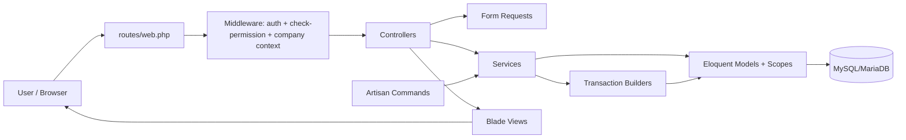

# Project Overview
Dakhl (دخل) is a Laravel 12 accounting/ERP application for Iranian businesses, focused on core bookkeeping,
invoicing, inventory cost flows, fiscal-year operations, payroll, and Iran tax compliance (including the
Moadian e-invoicing system), with Persian-first localization. Built on FreeAmir/امیر as upstream/base
heritage (not the product brand -- the GitHub repository is still named `FreeAmir`, hence that name still
appearing in repo URLs and some legacy docs). The project is active development software (not yet
production-ready), with business logic concentrated in services and transaction builders to protect
accounting invariants such as balanced documents and company scoping.

**For current product priorities and phase status**, read `docs/project-context/Dakhl_MASTER_CONTEXT_AND_ROADMAP_2026-09-20-r14.md` (always check for the LATEST "Current Verified Override"/numbered top-level section before trusting an earlier one -- see this file's own guardrail on roadmap staleness) and the corresponding tail of `docs/project-context/Dakhl_DECISION_LOG_2026-09-12-r4.md`. This file (AGENTS.md) documents durable technical conventions and guardrails, not product direction or phase sequencing.

## Repository Structure
- `.github/`: Repository automation and AI guidance (`copilot-instructions.md`), with no CI workflows yet.
- `app/`: Core application code, organized by Laravel layers and domain services.
- `app/Console/Commands/`: Custom Artisan commands (including fiscal-year import/export workflows).
- `app/DTO/`: Typed data-transfer objects used for service/domain decision payloads.
- `app/Enums/`: Domain enums for invoice status/type, config keys, and fiscal-year sections.
- `app/Helpers/`: Autoloaded helper functions/utilities (including Jalali date and number-to-word helpers).
- `app/Http/Controllers/`: HTTP endpoints and resource actions.
- `app/Http/Controllers/Auth/`: Authentication controllers and login/logout flow.
- `app/Http/Controllers/Management/`: User/role/permission management endpoints.
- `app/Http/Middleware/`: Cross-cutting request middleware (auth, permissions, company context, config).
- `app/Http/Requests/`: Form request validation classes for incoming HTTP payloads.
- `app/Models/`: Eloquent models for accounting entities (documents, invoices, products, customers, etc.).
- `app/Models/Scopes/`: Global scopes such as fiscal/company scoping rules.
- `app/Providers/`: Service providers and application bootstrapping hooks.
- `app/Services/`: Business logic layer, including accounting posting/building services.
- `app/View/Components/`: Reusable Blade view components.
- `bootstrap/`: Laravel bootstrap files and cached framework bootstrapping artifacts.
- `config/`: Laravel and package configuration (database, auth, queue, permission, translation, etc.).
- `database/`: Migrations, factories, and seeders for schema and test/demo data setup.
- `docs/`: Project/domain documentation (architecture, accounting basics, testing, database guides).
- `lang/`: Translation files for Persian and English locale strings.
- `public/`: Web root assets and front controller (`index.php`).
- `resources/`: Blade views plus source CSS/JS/fonts/images compiled by Vite.
- `routes/`: HTTP and console route definitions.
- `script/`: Data migration utilities and related import/export helper scripts.
- `storage/`: Runtime storage for logs, cache, sessions, compiled views, and app files.
- `tests/`: PHPUnit Feature and Unit test suites.
- `vendor/`: Composer-installed PHP dependencies (generated; do not edit manually).

## Main Packages
- `laravel/framework` `^12.0`: Core backend framework and application runtime.
- `laravel/sanctum` `^4.2`: Token-based authentication for API scenarios.
- `spatie/laravel-permission` `^6.4`: Roles and permissions authorization model.
- `carlos-meneses/laravel-mpdf` `^2.1`: PDF generation integration for Laravel.
- `doctrine/dbal` `^3.10`: Database abstraction helpers used for schema operations.
- `guzzlehttp/guzzle` `^7.2`: HTTP client for outbound service/API requests.
- `laravel/sail` `^1.44` (dev): Docker-based local development environment.
- `laravel/envoy` `^2.9` (dev): Deployment/remote task automation (`Envoy.blade.php`).
- `laravel/pint` `^1.0` (dev): PHP code formatting and style enforcement.
- `phpunit/phpunit` `^11.5.3` (dev): Unit and feature testing framework.
- `vite` `^7.0.7`: Frontend build tool/dev server.
- `laravel-vite-plugin` `^2.0.0`: Laravel integration for Vite assets.
- `tailwindcss` `^3.4.13`: Utility-first CSS framework used in the frontend build.
- `daisyui` `^4.12.23`: Tailwind component plugin/theme utilities.
- `alpinejs` `^3.14.8`: Lightweight frontend reactivity/interactivity layer.
- `chart.js` `^4.4.7` + `chartjs-plugin-datalabels` `^2.2.0`: Reporting/dashboard chart rendering.
- `@majidh1/jalalidatepicker` `^0.9.4`: Jalali date picker for Persian calendar UX.
- `sass` `^1.77.0` + `autoprefixer` `^10.4.20`: CSS preprocessing and post-processing pipeline.

## Build & Development Commands
- `sail up -d`: Start Laravel Sail containers.
- `sail npm run dev`: Start Vite development server.
- `sail npm run build`: Build frontend assets for production.
- `sail artisan test`: Run full test suite.
- `sail artisan test --filter=TestName`: Run targeted tests.
- `./vendor/bin/phpunit --filter testMethodName tests/Feature/ExampleTest.php`: Run a single PHPUnit method.
- `./vendor/bin/pint`: Format code with Laravel Pint.
- `sail artisan migrate --seed`: Run migrations and seed data.
- `envoy run deploy`: Deploy application.
- `envoy run init`: Initialize deployment.
- `envoy run rollback`: Roll back deployment.

When Sail is unavailable for one-off local tasks, use direct commands such as `composer`, `php artisan`,
and `npm`.

## Code Style & Conventions
- Follow PSR-12 for PHP code style.
- Use 4 spaces for indentation (2 spaces for YAML), UTF-8, LF line endings.
- Keep class names in PascalCase, methods/variables in camelCase, and DB fields in snake_case.
- Keep controllers thin; move business logic into `app/Services/` and transaction builders.
- Prefer Form Request validation via `app/Http/Requests/*Request.php`.
- Use dependency injection in controllers and leverage Laravel service container bindings.
- For multi-step data updates, use `DB::transaction()` and validation exceptions where needed.
- Follow RESTful controller method conventions: `index`, `create`, `store`, `show`, `edit`, `update`, `destroy`.
- Use Laravel Pint (`./vendor/bin/pint`) with default config (no `pint.json` is present).
- Preserve existing Persian business/domain comments where they provide accounting context.
- Preserve accounting invariants: balanced debit/credit postings and company data separation.

## Architecture Notes

Primary request flow is Route -> Middleware -> Controller -> Service -> Model/Builder -> Database,
with controllers handling HTTP concerns and services enforcing accounting rules. Multi-company and
fiscal scoping are enforced through middleware/session context and model scopes (for example
`FiscalYearScope`). Console commands (`fiscal-year:export`, `fiscal-year:import`) reuse the same domain
services for data migration and fiscal-year operations.

## Project Patterns & Reference Files
- Read `README.md` and `docs/project-structure.md` first for high-level onboarding.
- Service layer examples: `app/Services/` (for example `InvoiceService`, `FiscalYearService`,
  `CostOfGoodsService`).
- Transaction/invariant logic: `app/Services/*TransactionBuilder.php`.
- Validation patterns: `app/Http/Requests/` (for example `StoreInvoiceRequest.php`).
- Thin controller patterns: `app/Http/Controllers/InvoiceController.php`.
- Fiscal-year batch I/O examples:
  `app/Console/Commands/FiscalYearExportCommand.php`,
  `app/Console/Commands/FiscalYearImportCommand.php`.
- Scoping rules: `app/Models/Scopes/FiscalYearScope.php` and middleware such as
  `app/Http/Middleware/DefaultCompany.php`.
- Testing expectations and examples: `docs/testing-guide.md`, `tests/`.
- Data migration scripts: `script/README.md` and `script/`.

## Security & Compliance
- Keep secrets only in `.env`; do not commit credentials (`.env`, `auth.json`, keys are gitignored).
- Treat fiscal-year import/export and legacy migration scripts as sensitive operations; back up data first.
- Use least-privilege DB credentials and set production-safe env values (for example `APP_DEBUG=false`).
- Authorization relies on Laravel auth middleware and Spatie permission checks.

## Agent Guardrails
1. Never edit generated or dependency directories: `vendor/`, `node_modules/`, `public/build/`, runtime
   cache/log artifacts under `storage/`.
2. Never commit real credentials or tokens; use `.env.example` placeholders only.
3. Require human review before merging changes that touch accounting posting logic, especially:
   `app/Services/*TransactionBuilder.php`, `app/Services/CostOfGoodsService.php`, fiscal-year commands,
   `app/Services/ChequeService.php` (the cheque lifecycle: `register`/`deposit`/`clear`/`bounce`/`endorse`/
   `return`/`cancel`/`executeGuarantee` — never redesign or reuse these as a settlement mechanism), and
   `app/Services/SettlementService.php`/`PaymentService.php`'s allocation methods (CheckSettlement domain —
   see Decision D-070 in `docs/project-context/Dakhl_DECISION_LOG_2026-09-12-r4.md` for the binding contract:
   Instrument/Obligation/Settlement are three independent lifecycles that must never collapse into one, and
   only an actual `Payment` allocation may create an accounting effect).
4. Any change affecting financial calculations must include or update tests in `tests/Feature` or
   `tests/Unit`.
5. **Offline/Online Sync (Phase 2) is architecturally locked before implementation — see Decision D-071**
   in `docs/project-context/Dakhl_DECISION_LOG_2026-09-12-r4.md` for the full seven-point contract and the
   binding 2.1–2.8 implementation order. Do not build sync/identity code that assumes single-tenancy
   permanently, does not use UUIDs for the scoped entity list, invents provisional accounting document
   numbers, does a full-database-comparison sync instead of event/change-based, or silently rolls back a
   server-rejected local operation instead of surfacing an explicit conflict state. As sync/identity files
   are created (`SyncService`, pairing/activation code, Outbox/Inbox models), treat them as protected core
   requiring the same review discipline as item 3 above.
   **Stage 2.7 (Document/Invoice sync) additionally follows Decision D-073**: `Document` is the sync
   aggregate root and `Invoice` never syncs without an accepted parent `Document`; Draft vs
   Approved/Posted have separate sync policies (Draft syncs freely, Approved/Posted is strict and a
   rejection is a visible conflict, never a silent rewrite); document numbers commit only at
   finalization, never at Draft creation; hard `DELETE` must never reach the server for a financial
   document — only `Void`/`Cancel`/`Reverse`; sync must be dependency-aware (`Pending Dependency`, never
   a dropped record or a failed batch). Payment/Transaction/Posting/Cheque sync stay out of scope until
   stage 2.8. `SyncPilotService`/related Document/Invoice sync code falls under the same protected-review
   discipline as item 3.
   **Stage 2.7C (Invoice numbering) additionally follows Decision D-075**: a Reserved Range is for
   official/finalized numbers only, never Drafts; ranges are scoped to `(company_id, invoice_type,
   origin_device_id)` and are server-authoritative via a locked atomic reservation — never a naive
   `MAX(number)+1`; reserved-but-unused numbers are never recycled; reservation ≠ consumption — only a
   `Finalize` sync operation (through the same idempotent pipeline as every other operation) consumes a
   number and makes it immutable; the existing `invoices_number_invoice_type_company_id_unique` DB
   constraint remains the final collision guard. `NumberingLeaseService`/numbering-related
   `SyncPilotService` code falls under the same protected-review discipline as item 3.
   **Stage 2.7D (Sales Invoice approval/posting via sync) additionally follows Decision D-076**: FINALIZED
   and APPROVED/POSTED are two separate operations, never one; approval/posting is server-authoritative
   only (never offline) and re-runs the EXISTING `InvoiceService::getChangeStatusValidation()`/
   `changeInvoiceStatus()` — sync must never invent a second accounting engine; posted documents remain
   immutable through sync; Technical Retry / Business Rejection / Data Conflict are three distinct,
   never-conflated outcomes; posting is idempotent via the existing `operation_id`. `SyncPilotService`'s
   `applyApprove()`/`InvoiceService` calls from sync fall under the same protected-review discipline as
   item 3.
   **Stage 2.7E (Integration & Hardening, D-077) adds no new feature** — it proves 2.7A–2.7D compose
   correctly (partial batch failure, retry/operation_id preservation, crash-after-success, Finalize/Approve
   atomicity, stale-version-conflict vs idempotent-no-op, lifecycle enforcement, multi-device convergence,
   exactly-once posting). A real sync-infrastructure defect found during 2.7E is fixed in place; an
   accounting-semantics question is split into its own future Decision, never resolved ad hoc there.
   **Stage 2.8 (Payment/Financial Event sync) additionally follows Decision D-078**: Payment is a
   financial event, not an Invoice-like two-phase Draft — the existing atomic
   `Create Payment → Document → posting` behavior (`PaymentService`) is reused as-is, never reimplemented;
   a new `financial_event_uuid` identifies the economic event, distinct from `operation_id` (the sync
   attempt); Payment creation and Allocation stay fully separate; posted Payments are never hard-deleted
   through any runtime (Web, Offline, or Sync); Cheque lifecycle (`ChequeService`) stays fully independent
   of Payment Sync — never re-driven from it; accounting posting is exactly-once per `financial_event_uuid`.
   `SyncPilotService` code touching Payment falls under the same protected-review discipline as item 3.
   **Stage 2.8B (Offline Payment Creation + Sync) additionally follows Decision D-079**: Payment sync
   NEVER generically fills attributes onto `new Payment($attributes)` the way Customer/Product/Document/
   Invoice do — it must call the existing `PaymentService::createCreditPayment()`/`createPayment()`
   exactly once (one posting, by construction) and only then `forceFill` the resulting row's `uuid` to
   the client's `financial_event_uuid` (with `sync_version` reset to 1) as an identity fix-up, never a
   second creation. Allocation/Transaction/Cheque sync remain out of scope; hard `DELETE` via Sync is
   rejected for Payment. `SyncPilotService` Payment-handling code falls under the same protected-review
   discipline as item 3.
   **Stage 2.8C (Server Financial Authority & Reconciliation Gate) additionally follows Decision D-080**:
   this stage never rebuilds 2.8B's already-proven create/retry/idempotency mechanics. Same
   `financial_event_uuid` + matching payload is idempotent convergence; same uuid + different payload is a
   tamper/data conflict; different uuids are NEVER deduplicated by payload similarity; a server-side
   business-validation failure on a payment the device treated as posted locally must surface as a
   deterministic `REJECTED`, never a silent rollback. A recurring "bare row from a legacy/system path
   breaks a new model-event hook" pattern (4th occurrence: Document in 2.3, Document in 2.7A, Payment in
   2.8B) is a tracked Open Engineering Item — do not attempt a general refactor of it inside 2.8C.
   **Stage 2.8D (Payment Allocation Sync) additionally follows Decision D-081**: `PaymentAllocation` is
   its own independent Sync Entity (canonical `uuid`, no new `SyncOperation` — reuses `CREATE`); Sync
   never inserts into `payment_allocations` directly, only through the existing
   `PaymentService::allocate()`/`allocatePayment()` (which already provides the only locking/validation
   that matters); a capacity failure is a Business Rejection via the existing validation, never a
   sync-invented remaining-amount check; an Allocation rejection must never alter the Payment's own
   `sync_status`; DELETE/reversal of an Allocation is out of scope.
   **Stage 2.8E (Distributed Payment & Allocation Integration Hardening) adds no new feature (Decision
   D-082)** — it proves the whole 2.8A–2.8D chain composes correctly (Payment-succeeds/Allocation-fails
   leaves no blind rollback; chained retries/crash-recovery never duplicate; D-080's identity distinction
   holds at the chain level; conflicting cross-device allocations are decided entirely by existing
   `PaymentService` validation; hard delete/invalid mutation stay rejected everywhere). If reversal,
   Cheque integration, Trade, Customer→Subject redesign, a new posting engine, a new `SyncOperation`, or
   a generic conflict framework surfaces as apparently necessary, STOP and report — never expand scope
   to absorb it.
   **Stage 2.8B/2.8D completion (D-083) additionally requires**: `PaymentAllocation` local creation must
   auto-enqueue to the Outbox via `App\Models\Concerns\SyncsPaymentAllocationsToOutbox`, symmetric with
   Payment's own `SyncsPaymentsToOutbox` — only Invoice-targeted allocations are eligible, matching
   `paymentAllocationSyncViolation()`'s server-side boundary. Do not add an UPDATE/DELETE enqueue path for
   either trait — CREATE-only remains locked (D-079 decision 7/D-081 decision 7).
   **Posted financial record immutability (D-084)**: `PaymentService::deletePayment()` (non-cheque branch)
   and `PaymentService::removeAllocation()` unconditionally reject via `rejectPostedFinancialMutation()` —
   a posted Payment/PaymentAllocation is never deleted or destructively modified through the service layer,
   matching what Sync already enforced. The cheque-linked branch of `deletePayment()` is explicitly
   preserved and must NOT be folded into this guard — deleting a cheque-linked Payment is independent
   Cheque lifecycle behavior (D-070), never redesigned here. Do not implement Reversal/Correction as part
   of this guard; that is a future, independent Decision. One identified-but-not-fixed bypass of this
   guard remains open: `SettlementService::unsettleInstallment()` (deletes a `PaymentAllocation`
   directly, bypassing D-084's guard). **Correction (Phase 3 audit, post-D-088)**: this is NOT dead code --
   `tests/Feature/CheckSettlementTest.php::test_unsettling_an_installment_restores_the_remaining_amount`
   calls it directly and relies on its behavior; it is simply not wired to any controller/route yet, so it
   is unreachable from the web UI. Do not remove it. Do not wire up `unsettleInstallment()` to any future
   feature without first revisiting D-084.
   **Post-Phase-2 hardening (still D-084, no new Decision)**: the OTHER identified bypass —
   `Invoice::deleting()`'s bulk allocation delete + the `payments.invoice_id` `cascadeOnDelete()` FK — is
   now closed: `Invoice::booted()`'s `deleting` hook rejects deletion of any invoice with a non-cheque
   Payment or any PaymentAllocation, for the same reason as `PaymentService`'s own guard. Cheque-linked
   invoices are excluded (same D-070 carve-out — `InvoiceService::deleteInvoice()` already removes a
   cheque-linked Payment via `ChequeService::delete()` before this hook runs). Do not relax this guard,
   and check for an equivalent bypass before adding Sync/immutability rules to Document or Transaction.
   **Company deletion provenance (D-085)**: `Company::booted()`'s `deleting` hook rejects deleting a
   company that has any approved `Document` with `provenance = FinancialProvenance::NATIVE`, or any
   `PaymentAllocation` (never copied by any import path, so its mere existence is a reliable native-
   activity signal). A copied/imported `Document` is tagged `FinancialProvenance::BASELINE` only inside
   `FiscalYearService::_importDocuments()` — the single choke point every copy/import path routes
   through. Do not add a second place that sets `provenance`, and do not treat a bare `is_copied` flag
   as sufficient — provenance must stay record/operation-level, not company-level.
   **Approved Invoice Mutation Boundary (D-086 + D-087 + D-088 + D-089)** — CLOSED, exhaustively
   enumerated: once an Invoice has real financial activity (`Payment` or `PaymentAllocation`),
   `InvoiceService::hasEffectiveFinancialActivity()` gates all four mutation directions at the SERVICE
   layer itself, never only at a caller: edit/rebuild (`updateInvoice()`, D-086), unapprove
   (`unapproveInvoice()`, D-087), re-approve (`userFacingApproveInvoice()`, D-088), and reject
   (`userFacingRejectInvoice()`, D-089). `GroupActionService`'s legitimate internal COG-chain recycling
   uses its own separate, deliberately unguarded primitive
   (`recycleInvoiceStatusForDependencyRecalculation()`, D-087) — never route a new caller through that
   primitive without confirming it is non-financial. Delete is covered separately (Batch A, pre-dates
   D-086): `Invoice::booted()`'s `deleting` hook. The pattern for any future shared-primitive-with-
   mixed-trust-callers problem is: a separate guarded wrapper for the user-facing path, never a boolean
   bypass/force/internal flag on the shared primitive.
   **Decision D-074 (Trade/Consignment Architecture) is documentation-only, future architecture** — do
   not write any migration, model, service, route, or sync code for `Trade`/`Deal`/`Consignment`/
   `Open Exchange`/`Position`/multi-unit `Valuation`, and do not add a `GenericTradeEntity`/
   `GenericPosition`/`GenericValuation`/`UniversalSettlement` abstraction to any existing code "for
   later." Stage 2.7 continues purely on the existing `Document`/`Invoice` model until an owner
   explicitly opens a Trade build phase.
6. Do not run destructive DB operations (`migrate:fresh`, bulk imports) against non-local environments.
7. Do not change posting/transaction behavior without corresponding tests and explicit domain review.
8. **`invoices.approve` is a real, separately-enforced permission, distinct from `invoices.store`/`invoices.update`/`invoices.change-status`** (Phase 8 finding, post-D-089): `InvoiceController::store()`/`update()`/`changeStatus()` all call `abort_unless(auth()->user()->can('invoices.approve'), 403)` before allowing `approve=1`/any status transition. The Seller role deliberately lacks this permission while having `invoices.store`/`invoices.update` — do not "simplify" these three checks into a single shared permission with `invoices.store`/`invoices.update`, and never call `->can(...)` for an authorization decision without acting on its return value. The exact same defect (discarded `can('ancillary-costs.approve')`) also existed in `AncillaryCostController::store()`/`update()`/`changeStatus()` and was fixed identically (Financial Integrity Closure Batch) — check both controllers before touching either permission.
9. **`ChequeService::bounce()`/`returnToCustomer()`/`cancel()` must all call `reverseInvoicePaymentCredit()`** (Financial Integrity Closure Batch, Section 5 finding): any lifecycle transition meaning "the cheque was never actually collected/given" (bounced, returned to the customer without depositing, or a mistakenly-issued cheque cancelled before deposit) must reverse the invoice-linked Payment created at registration time, or the invoice stays incorrectly marked PARTIALLY_PAID/PAID. `return`/`cancel` were both missing this call until this batch (zero prior test coverage on either action is how the gap went unnoticed) — `endorse` correctly does NOT reverse it (the customer's invoice genuinely was settled by that cheque; what the business does with it afterward is a separate matter). Any future new lifecycle transition meaning "this cheque did not actually get paid/collected" must call `reverseInvoicePaymentCredit()` too.
10. **`SettlementService::unsettleInstallment()` remains an intentionally untouched, open D-084 question** (Financial Integrity Closure Batch, Section 4): exhaustively re-confirmed zero callers anywhere except tests (no route/controller/job/listener/console wiring exists). It directly bypasses `PaymentService::removeAllocation()`'s D-084 guard by deleting a `PaymentAllocation` row directly. D-084's own original text already flagged this and explicitly deferred its resolution to "a future Decision." Guarding it would delete real, tested functionality (a policy choice, not a bug fix); leaving it is the status quo (zero live exposure, fully unreachable); wiring it up to a real UI would require designing Reversal/Correction semantics D-084.5 explicitly defers. Do not resolve this without an owner decision -- see the Decision Log's dedicated disposition note.
11. **`ChequeService::delete()` guards against orphaning a settled `SettlementObligation`** (Sequential Roadmap Execution Queue, Batch 1): `settlement_obligations.source_id` has no FK (polymorphic, by design). Deleting a Cheque with a `SettlementObligation` that has real `PaymentAllocation` activity is rejected; an Obligation with no payment yet does not block deletion (mirrors the Invoice-deletion guard's own "no payment yet" exception). Do not relax this guard.
12. **`FiscalYearService::_importCustomers()`/`_importInvoices()` must both explicitly assign `uuid` before `saveQuietly()`** (Batch 4, mirroring D-085's original finding): `saveQuietly()` suppresses `HasSyncEnvelope`'s `creating` hook, and `uuid` has no DB default (unlike `sync_version`/`sync_status`). Before adding any NEW `_import*()` method that creates a row for a model using `HasSyncEnvelope` (`Document`, `Invoice`, `PaymentAllocation`, `Payment`, `Product`, `Customer`, `Subject`, `Transaction`) via `saveQuietly()`, check this pattern first.
13. **`InvoiceTransactionBuilder`'s per-transaction rounding is centralized in `pushTransaction()`** (Batch 2): every transaction value must go through this helper, never a raw `$this->transactions[] = [...]` push. `average_cost`/`unitPrice`/`returnedCost` multiplied by a (real, `decimal(10,2)`, sometimes-fractional) `quantity` can produce more than 2 decimal places -- do not reintroduce a raw push site when adding new transaction-building logic to this class.
14. **`ChequeService::update()` also rejects editing once a `SettlementObligation` exists for the cheque** (Final Closure Pass): `createObligationForCheque()` has no status precondition, so an obligation can exist for a still-editable (never-transitioned) cheque; `SettlementObligation.original_amount` is a one-time snapshot that never re-syncs. Do not relax this guard, and apply the same "something meaningful already happened, register a replacement instead" reasoning to any future thing that snapshots a cheque's amount.
15. **D-090 is RESOLVED, not open**: `SettlementService::unsettleInstallment()` now delegates to `PaymentService::removeAllocation()` (always rejects with a `ValidationException`) instead of hard-deleting the `PaymentAllocation`. This is a mechanical application of D-084's already-decided rule (never a sanctioned Settlement exception like Cheque's registration-payment deletion), not a new policy. A real, governed Settlement reversal capability remains a *future*, separate architecture decision (D-084.5) if the owner ever wants one -- do not re-introduce direct deletion here without that decision.
16. **Never assume a status-toggle method is idempotent against being called twice with the same target status -- verify it explicitly** (Final Marathon Closure Pass): `InvoiceService::userFacingApproveInvoice()`/`unapproveInvoice()` and `AncillaryCostService::changeAncillaryCostStatus()` all had the identical defect -- re-applying the same status (e.g. "approve" on an already-approved, financially-clean record) fell through to unconditionally re-run the full mutation (new Document created, orphaning the old one; warehouse quantity re-added/re-subtracted), with **no concurrency required** to reproduce -- a plain resubmit was enough, and this was completely invisible to a green test suite until specifically tested. All three now check the current status first and no-op safely if already in the target state, matching the idempotent-replay principle `SyncPilotService::applyApprove()` already used (D-076 decision 6). Before adding any NEW status-toggle method (approve/unapprove/settle/etc.) to any service, check whether re-invoking it with the same target status while already in that status is a safe no-op -- do not assume the controller or an upstream check already prevents this; verify with a test that literally calls the transition twice.
17. **Roles are now company-scoped via Spatie's `teams` feature (r12, D-091)** -- `company_id` is the team foreign key. The 6 seeded role DEFINITIONS (Super-Admin, Admin, Accountant, Warehousekeeper, Seller, Employee) stay global/shared (`roles.company_id IS NULL`); only the ASSIGNMENT (`model_has_roles`/`model_has_permissions` pivot rows) is company-scoped. Super-Admin's assignment and the two Super-Admin-exclusive permissions (`access-super-admin-panel`, `update-global-configs`) use the reserved sentinel company id **0** (never NULL -- that column is NOT NULL and part of a composite primary key) and are checked via `User::isSuperAdmin()`/`User::hasGlobalPermission()`, which bypass Spatie's team-scoped `roles()`/`permissions()` relations entirely -- **never check these two with `hasRole('Super-Admin')`/`can('access-super-admin-panel')` from code that must work regardless of active company** (e.g. `Gate::before`), since Spatie's own relation strictly matches the CURRENT team context and would incorrectly return false. Team context resolves via `App\Support\CompanyPermissionsTeamResolver` (`config('permission.team_resolver')`), which defers to the SAME `getActiveCompany()` helper every other company-scoping mechanism uses -- do not add parallel `setPermissionsTeamId()` plumbing to middleware; only call it explicitly when a single request must deliberately target a DIFFERENT company than the active one (see `UserController::syncCompanyScopedRoles()`, `CompanyController::createCompany()`), and always **clear it with `setPermissionsTeamId(null)`** in a `finally` block afterward -- never "restore" a captured numeric value (see guardrail #19 for why that specific mistake silently re-pins a stale company).
18. **Never add a foreign key to the `roles` table (or run any ALTER on it) in a migration that runs while `model_has_roles`/`model_has_permissions`/`role_has_permissions` still hold rows referencing it, without first checking whether SQLite would silently wipe them** (D-091 migration, empirically verified and fixed): SQLite cannot add a FOREIGN KEY to an existing table via a plain `ALTER TABLE`, so Laravel's SQLite grammar transparently rebuilds the whole table (create new, copy rows, drop old, rename) to fake it. Because `model_has_roles.role_id`/`role_has_permissions.role_id` both have `onDelete('cascade')` back to `roles.id`, that rebuild's internal "drop the old roles table" step **cascades and silently deletes every row** in both dependent tables -- with no error, no exception, just silently empty tables after commit. This is real on SQLite (the desktop/NativePHP build's actual database engine, not just a testing convenience) and was caught only by writing a migration test that replays the legacy-upgrade path (`tests/Feature/CompanyScopedRoleMigrationTest.php`) rather than trusting a fresh RefreshDatabase run, which never exercises the vulnerable path at all. Before adding any FK to a table that already has cascade-deleting dependents, verify with a test seeded through the *pre-migration* schema, not just a fresh install. Also verified safe on real MariaDB (no such rebuild-cascade behavior there).
19. **`can()`/`hasPermissionTo()` use Spatie's WILDCARD permission checker in this app** (`config('permission.enable_wildcard_permission') = true`, pre-existing), which caches a per-user "wildcard permission index" on the `PermissionRegistrar` singleton and does **not** know about team/company context at all (D-091, Workstream T, empirically verified as a real defect and fixed). Checking a user's permissions in Company A, then switching team context to Company B and checking again, would silently keep returning Company A's permission set unless the index is invalidated on every genuine team change -- `hasRole()` alone is never affected (it queries fresh every time); only the wildcard-backed `can()` path is. `App\Support\CompanyPermissionsTeamResolver::getPermissionsTeamId()`/`setPermissionsTeamId()` now invalidate on every resolution whose value differs from the last one returned -- this is why `setPermissionsTeamId()` must always be **cleared with `null`**, never "restored to a captured value" (a captured value can itself be stale by the time it's restored, permanently re-pinning the wrong company and defeating this same invalidation). If you ever touch this resolver, do not remove that comparison-and-invalidate logic, and do not assume `hasRole()`'s correctness implies `can()`'s correctness -- they go through completely different code paths under wildcard permissions.
20. **Role assignment/removal is now audited** (D-091, Workstream Q): `config('permission.events_enabled') = true`, with a listener in `AppServiceProvider::boot()` recording `RoleAttached`/`RoleDetached` to the `security` activity log source. This exists because `model_has_roles` changes go through raw pivot-table queries (`attach`/`detach`/`sync`), never firing an Eloquent model event, so they were completely invisible to the existing generic model-event listener. Direct permission grants (`givePermissionTo`/`revokePermissionTo` on a User) are NOT currently audited this way -- if that pattern becomes real product usage (today it is test-only, see `RolesAndPermissionsSeeder`'s comments on `access-super-admin-panel`), add a corresponding listener for Spatie's `PermissionAttached`/`PermissionDetached` events the same way. Company membership changes (`company_user` attach/detach/sync) are ALSO not audited this way (no Spatie event exists for that pivot; it is a plain custom `belongsToMany`) -- this remains an explicit, documented gap (see Decision Log D-091 "What this pass did NOT complete").
21. **`company_user` has a real, enforced `unique(['company_id', 'user_id'])` constraint (D-091, Workstream R)** -- never attach a Company to a User (or vice versa) with raw `->attach(...)` in a test; always use `->syncWithoutDetaching(...)`, matching every production code path (`UserController`, `CompanyController`) and `CompanyFactory`'s own `afterCreating` hook. `attach()` does not check for an existing pivot row first, and `CompanyFactory` already silently attaches `User::first()` to every company it creates -- a raw `attach()` call for a user that happens to coincide with `User::first()` will hit the unique constraint and fail with an integrity-constraint-violation error, not a clear validation message. This was a real, previously-undetected pattern across 59 test files (94 call sites) before this phase fixed it at the source; do not reintroduce it in new tests.
22. **Before adding ANY route that binds an Eloquent model by id, check whether that model has `FiscalYearScope`** (`app/Models/Scopes/FiscalYearScope.php`, applied via `static::addGlobalScope(new FiscalYearScope())` -- currently on 31 models). If it does, route-model-binding alone already prevents cross-company access (a wrong-company id 404s automatically). **If it does NOT** (confirmed gap-prone models so far: `Payment`, `PaymentAllocation`, `SettlementObligation`, `SettlementInstallment`, `Comment`, `DocumentFile`, `Transaction`, `WorkSiteContract`, `PayrollItem`, `DeviceInstallation`, `SyncConflict`), the controller MUST explicitly verify company ownership before acting -- either `abort_unless($child->parent_id === $parent->id, 404)` when nested under an already-scoped parent (the pattern `PaymentController`, `DeviceController`, `SyncConflictController` already used correctly), or `abort_unless($model->companyDerivingRelation?->company_id === getActiveCompany(), 404)` when standalone. This exact gap (a generic permission being treated as sufficient, with no resource-ownership check) was found and fixed once for `RoleController` in Workstream A-I, and recurred in 7 more controllers before a full route-vs-scope audit (Workstream J) caught it -- `PaymentAllocationController::allocate()` in particular let one company allocate ANOTHER company's payment to its own invoice, a real cross-tenant financial integrity breach. `Payment::resolvedCompanyId()` is the reusable pattern for a model whose company is only derivable through one of several possible relations. See `tests/Feature/CrossCompanyResourceAccessTest.php` for the regression coverage and Decision Log's "Workstream J permission-matrix audit" entry for full detail.
23. **A status-transition method that reads current status, validates the transition, then writes -- without `lockForUpdate()` -- is racy even when it already has a same-status/repeat-transition guard** (Workstream L/M/S adversarial concurrency audit): the existing idempotency guards on `PayrollStatus::transitionPermissionTo()`, `InvoiceService::userFacingApproveInvoice()`/`unapproveInvoice()`, `AncillaryCostService::changeAncillaryCostStatus()`, `PersonnelRequestController::approve()`/`reject()`, etc. only protect against SEQUENTIAL re-invocation (call 1 fully commits, call 2 then sees the new state). Two genuinely CONCURRENT requests both read the pre-write status before either commits, both pass the guard, and both write. Three real instances of this were found and fixed by direct reproduction (two independently-fetched stale model instances, both passed to the method directly, simulating what two overlapping HTTP requests would each observe): **`PayrollController::transition()`** (a duplicate `PayrollStatusHistory` row per race -- final `status` coincidentally still correct, audit trail corrupted) and, more severely, **`InvoiceService::changeInvoiceStatus()` / `AncillaryCostService::changeAncillaryCostStatus()`** (a second, orphaned `Document` plus double-posted inventory/COG per race -- the exact disaster the SEQUENTIAL guardrail #16 fix was built to prevent, reached through the concurrent door that fix cannot close). All three fixed the same way: `DB::transaction()` + `Model::query()->lockForUpdate()->findOrFail()`, re-reading fresh state INSIDE the lock rather than trusting the route-bound/caller-supplied instance -- mirroring the pattern `ChequeService::transition()` already used safely. For Invoice/AncillaryCost specifically, the fresh state is copied onto the CALLER'S OWN instance via `setRawAttributes()` rather than swapping in a separate `$locked` variable, because `SyncPilotService::applyApprove()` keeps mutating the same `$existing` object after calling `changeInvoiceStatus()` (`$existing->forceFill([...])->save()`) -- a detached fresh instance would have silently reverted the approval when that later save ran with stale attributes. **Before assuming a race is exploitable, verify the side effect actually accumulates raw state** -- the identical-looking suspected race in `PersonnelRequestController::approve()`/`reject()` turned out to be safe without any lock, because `AttendanceService::syncPersonnelRequestLogs()` calls `recalculateLog()`, which rebuilds the day's attendance fields from the current set of *approved* `PersonnelRequest`s rather than trusting a running counter -- a doubled call re-derives the same value instead of doubling it (idempotent-by-reconstruction, a third valid safety pattern alongside the match-table and the pessimistic lock). Reproduce a suspected race with two independently-fetched stale model instances calling the method directly (bypassing route-model-binding's own fresh-per-request read) rather than assuming from code-reading alone -- see `tests/Feature/WorkflowApprovalIdempotencyTest.php` and `tests/Feature/InvoiceApprovalConcurrencyTest.php`.
24. **A "check a live aggregate/existence query, then write" pattern is racy across DIFFERENT rows too, not just same-row status flips -- and proving it needs a REAL second database connection, never the stale-instance trick** (Workstream S, Phase 1 deep audit): unlike guardrail #23's same-row status races, `PaymentService::createPayment()`/`allocatePayment()` (checking an Invoice's live remaining balance before recording a payment/allocation from a DIFFERENT Payment row), `DocumentService::createDocument()` (computing `Document::max('number') + 1` with no lock, hit on every credit/invoice payment), and `BankReconciliationService::matchLine()` (checking whether a Transaction is already matched by a DIFFERENT BankStatementLine) all read a live query result and write based on it, racing against a genuinely CONCURRENT second transaction rather than a stale in-memory object -- SQLite `:memory:` cannot even represent this class of bug (every connection is its own private database), and calling the method twice sequentially in the same process never reproduces it either (the first call's transaction always fully commits before the second starts). All three were reproduced and fixed using `tests/Helpers/MariaDbRaceTestCase.php`, which points the app at a real local MariaDB scratch schema and drives two independent Laravel connections under the test's own explicit control (begin on A, act, then act on B while A is still uncommitted). Fixed the same way in all three: lock the contended row (`Invoice`/`Document`-max-row/`Transaction`) inside the transaction before checking or writing.
    **The critical trap when writing this style of test**: Eloquent's `Model::create()` and query-result hydration (`Builder::newModelInstance()`) PIN a model instance's connection to whatever `config('database.default')` was AT THAT EXACT MOMENT (`->setConnection($this->query->getConnection()->getName())`) -- later changing `config('database.default')` does NOT repoint an already-loaded instance; it keeps silently using its original connection (visible via `$model->getConnectionName()`). Fetching `$invoice`/`$line`/`$transaction` once in `setUp()` (before any connection-swapping) and reusing that SAME object for both "sides" of the race means EVERY query and write run through it (relationship queries, `->update()`) silently happens on ONE pinned connection regardless of which side is supposedly "acting" -- while any FRESH static call (`Invoice::query()->lockForUpdate()->find()`, `Model::create()`) made AFTER the config swap correctly follows it. This produces convincing-looking but methodologically hollow results: a pre-fix "proof" can show the wrong symptom for the wrong reason (a write silently autocommitting on the pinned connection instead of genuinely racing), and a post-fix check can show blocking that has nothing to do with the fix being tested (a DIFFERENT, unrelated lock on the pinned connection's shared 'mysql' session catching it instead). Always fetch a fresh, explicitly-bound copy for each side (`Model::on('mysql_a')->find($id)`), never reuse one pre-existing instance across both -- and if a "blocked" assertion passes, check the exception's actual query/table before trusting it proves what you think it proves (two of this pass's own draft tests initially reported the wrong lock as the cause and had to be corrected). See `tests/Feature/InvoicePaymentBalanceRaceTest.php` and `tests/Feature/BankReconciliationMatchRaceTest.php`'s docblocks for the full worked example.
25. **A "does it block?" test cannot distinguish fixed from unfixed for a naive `+=`/`save()` read-then-write bug, unlike guardrail #24's aggregate-query races** (Workstream S, Phase 3): ANY `UPDATE` to a row already takes MySQL's ordinary exclusive lock regardless of whether the preceding read used `lockForUpdate()` -- so a test that just checks "did the second connection block/timeout" will show blocking either way, for the unrelated reason that any write-write conflict blocks, and cannot prove the fix is doing anything. What actually needs proving is WHAT VALUE the second writer ends up computing, which requires exploiting MySQL's documented distinction between a plain (snapshot-bound) consistent read and a `SELECT ... FOR UPDATE` (latest-committed) locking read. Even that has a further real limit worth knowing before spending time on it: MariaDB raises error 1020 ("Record has changed since last read") the moment a transaction with an ALREADY-established snapshot (from ANY earlier read in that same transaction, on ANY table) performs a write against a row a different, already-committed transaction modified -- for BOTH plain and `lockForUpdate()`-based reads -- so this specific consistency failure mode is not actually preventable by adding a lock; it is MariaDB's own protection converting what would be silent corruption into a retriable error either way. This was hit while investigating `ProductService::addProductsQuantities()`/`subProductsQuantities()` and `CostOfGoodsService::updateProductsAverageCost()` (both fixed anyway, as defensive hardening matching the sibling `WarehouseProductStock` lock pattern, since no regression risk exists) -- but neither could be shown to silently corrupt data in ANY interleaving tried, unlike guardrails #23/#24's confirmed-exploitable findings. Not every structural inconsistency with an established locking pattern is an exploitable bug; say so explicitly (see `tests/Feature/ProductQuantityRaceTest.php`'s docblock) rather than reporting it as a CRITICAL finding to match the pattern of prior real ones.
26. **A per-entity name-validation regex enforced on the web form is not automatically enforced on that entity's CSV import path -- check every import service separately** (Workstream T, Security Hardening): `StoreProductRequest`/`UpdateProductRequest`/`StoreCustomerRequest`/`StoreServiceRequest` all restrict `name` to a safe character set (rejecting `<>"'`), but `ProductImportService`/`CustomerImportService`/`ServiceImportService` each independently implement their own row-parsing loop and had applied no such restriction at all -- only `trim()`. This was a real, exploitable stored XSS: `InvoiceStatusDecision::formatConflicts()`'s 'product' branch renders a conflicting Product's `name` unescaped (`{!! !!}` via `<x-show-messages>`), so an imported name bypassing the web form's validation could inject a script that runs in any staff member's browser the next time an ordinary invoice-approval conflict involving that product occurred. Fixed with `e()`-escaping at the actual output point (defense in depth, protects future rendering paths too) plus a `<>"'` denylist added to all three import services. **Do not copy the web form's own allowlist regex (`/^[\w\d\s...]*$/u`) into an import validator expecting it to be equivalent** -- PCRE's `\w` (even with `/u`) does not match Persian typography's zero-width non-joiner (U+200C, used in compound words like "نوشت‌افزار"), which is legitimate, common business data in a Persian-language app; a first draft of this fix that mechanically copied the allowlist broke an existing test using exactly such a name. Use a narrower, purpose-built denylist for security-motivated import validation instead of assuming a web form's allowlist regex is safe to reuse verbatim.
27. **Laravel's `throttle` middleware needs a per-test cache reset, or it silently makes the test suite order-dependent** (Workstream T): adding `throttle:6,1` to `/login` (a real, confirmed missing-rate-limiting fix -- the route previously had unlimited login attempts, unlike every other sensitive auth route which already used this exact convention) exposed that the test suite had no per-test cache isolation. `throttle` counts EVERY request to a route within its window (not just failures) and keys by client IP -- the same fixed IP for the whole suite -- so the CUMULATIVE count of requests to a newly-throttled route across every test file that hits it, within a run completing in well under 60 seconds, can exceed the limit and 429 an unrelated, otherwise-correct test, non-deterministically depending on execution order. `RefreshDatabase` already gives every test a clean-slate database via transaction rollback; nothing gave the cache store the same guarantee. Fixed globally in `tests/TestCase.php`'s `setUp()` (`Cache::store()->flush()` before every test) rather than locally in the one test that surfaced it, since any future rate-limited route would hit the identical problem. If you add `throttle` middleware to any route with test coverage, verify the full suite (not just the directly-affected test file) stays green -- this class of failure will not show up running the new test in isolation.
28. **"Workstream T" is a naming collision in this codebase's own documentation -- do not assume the two are the same thing.** Guardrails #26/#27 (and the Decision Log's "Eighth/Ninth continuation pass" sections, Execution Log Entries 67-69) use "Workstream T" for a freestanding **Security Hardening** sweep (XSS, rate limiting, dependency CVEs, security headers) started immediately after Workstream S (Concurrency) closed. This is a DIFFERENT thing from the roadmap's own, earlier-established **Workstream T = Permission Cache / Team Isolation** (`Dakhl_MASTER_CONTEXT_AND_ROADMAP...-r14.md` §37.6, the J-AA Organization Authorization letter sequence) -- an unrelated Spatie wildcard-permission-cache/company-context defect, already closed independently. Neither supersedes the other; they are disjoint in scope and both stand as recorded. See roadmap §38.2 for the explicit reconciliation note. Do not "resolve" this by renaming already-written history in either the Decision Log/Execution Log or the roadmap -- if a workstream letter is ever needed for the Security Hardening sweep in a future J-AA-style table, use **BB** (after AA), never a letter already assigned in §37.6. Also recorded here: **Finding #4 of that sweep** added a global `SecurityHeaders` middleware (CSP/X-Frame-Options/nosniff/Referrer-Policy/conditional HSTS) -- before adding any new external script/font/CDN reference to a Blade view, check this middleware's CSP first (`default-src 'self'`), since an unlisted external host will be silently blocked by the browser, not by a Laravel-level error. Device-pairing (`POST /api/devices/pair`) also gained `throttle:10,1` purely for convention-consistency (its 36^8-keyspace/15-minute-TTL activation code was explicitly reasoned through and confirmed NOT practically brute-forceable even unthrottled) -- do not mistake this for a proven vulnerability fix if revisiting that endpoint later.
29. **Never trust a vendor package's own default config to have sane security defaults -- verify every third-party package's registered routes the same way first-party ones are audited** (Workstream J closure batch, CRITICAL finding #12): `barryvdh/laravel-translation-manager`'s entire `/translations/*` route group (11 routes) shipped with its `'route' => ['middleware' => ...]` config key commented out, meaning it was registered with literally NO middleware -- not even the `web` group, so no session, no CSRF, no auth, no permission check at all. `postEdit()`/`postAdd()`/`postDelete()` let anyone overwrite any translation string application-wide with zero authentication. This was only caught because building Workstream J's actual permission-matrix artifact required enumerating and classifying EVERY registered route via `php artisan route:list --json`, not just the app's own first-party controllers -- a targeted vulnerability sweep (like the earlier Security Hardening pass) would not have found this, since it's not app code. Fixed by setting `'middleware' => ['web', 'auth', 'permission:access-super-admin-panel']` in `config/translation-manager.php`, reusing the exact same gate the `management` dashboard already uses for this class of system-configuration tool -- do not invent a new permission for a system-admin-only screen when `access-super-admin-panel` already exists and fits. Before adding or upgrading ANY package that registers its own routes (translation managers, debug toolbars, admin panels, queue dashboards, etc.), check its route-group config for a commented-out or missing `middleware` key -- this class of gap is invisible to `grep`ping application code, since the vulnerable code lives entirely in `vendor/`. See `tests/Feature/TranslationManagerAuthorizationTest.php` for the regression coverage.
30. **`getActiveCompany()` (`app/Helpers/helpers.php`) must NEVER fall back to reading a raw request cookie directly -- `Cookie::forget()` cannot protect against this** (Workstream U, CRITICAL finding #13, the single most severe finding of the entire mission): it previously fell back to `Cookie::get('active-company-id')` whenever `config('active-company-id')` was `null`. `Illuminate\Support\Facades\Cookie::get()` reads straight from `$app['request']->cookie($key)` -- the CURRENT, incoming, attacker-controlled cookie -- completely bypassing any validation. `DefaultCompany` middleware DOES correctly reject a cookie naming a company the user isn't a member of (`$company->users->contains(auth()->id())`), and calls `Cookie::forget()` plus sets `config(['active-company-id' => null])` on rejection -- but `Cookie::forget()` only queues an EXPIRING cookie for the OUTGOING response; it can never alter the CURRENT request's already-parsed incoming cookie value. So the exact post-rejection state (`config()` null, original spoofed cookie still on the request) was precisely what made the fallback trust the raw value anyway -- any authenticated user could set `active-company-id` to ANY company id and gain full read/write access to that company's entire `FiscalYearScope`-scoped dataset (31 models: every Document, Invoice, Cheque, Payroll, Transaction, Subject, etc.), regardless of actual membership. Fixed by removing the cookie-fallback branch entirely -- every real request path (`DefaultCompany` for web, `SetApiCompany` for api, `AuthenticateDevice` for device/sync) already sets `config('active-company-id')` correctly before this helper is ever called, so the fallback was dead weight for legitimate requests and live-exploitable for illegitimate ones. **Do not reintroduce any fallback in this helper that reads request-supplied data (cookie, header, query param) without re-deriving it through one of those three middleware's own membership-validated logic** -- the only safe fallback left is the deterministic "first persisted company" default for CLI/console/queue contexts, which involves no attacker input at all. See `tests/Feature/ActiveCompanyCookieSpoofingTest.php` and `tests/Feature/AdversarialCrossCompanyTest.php::test_setting_the_active_company_cookie_to_a_company_not_a_member_of_is_rejected` for regression coverage, and note `Invoice::creating()` unconditionally overwrites `company_id` with `getActiveCompany()` (unlike `Cheque::creating()`'s `??=`) -- any test creating an Invoice for a specific company must wrap the `Invoice::create()` call itself in that company's active context, not just pass `company_id` as an attribute.
31. **Before implementing ANY feature a prompt describes ("build X"), check whether X already exists** (Epic Pack 2 redirect): the owner's own prompt asked to build Payment Allocation/Bank Reconciliation/AR-AP Ageing from scratch with a specific schema (`invoice_id` FK, etc.) -- all three already existed, fully implemented with a DIFFERENT (polymorphic, D-070-locked) schema, dating from 2026-09-14/15. Blindly following the prompt would have created conflicting migrations and broken ~40 existing tests. Always run a quick `Glob`/`Grep` check for existing migrations/services/controllers matching the requested feature name before writing new ones -- this mission has now hit this exact staleness class multiple times (roadmap-vs-repository for L/M, and now prompt-vs-repository here).
32. **`BankStatementLine`/`Transaction` have no `FiscalYearScope` of their own -- any NEW controller action that looks either up (by route parameter OR by an id in the request body) needs its own explicit company check** (Epic Pack 2 audit, CRITICAL finding #14): `BankReconciliationController::match()`/`unmatch()` route-bound `{line}` (a `BankStatementLine`, company only derivable via `bank_account_id` -> `BankAccount`, which IS scoped) and `match()`'s own `transaction_id` (from the request BODY) both had zero ownership check -- the same defect class as Workstream J's original 7 gaps, missed there because route-enumeration alone doesn't see body-sourced ids. Fixed with `abort_unless(BankAccount::whereKey($line->bank_account_id)->exists(), 404)` (leverages BankAccount's own scope) and `abort_unless($transaction->document?->company_id === getActiveCompany(), 404)` (mirrors `TransactionController::show()`'s established pattern). Before adding any code that looks up a `Transaction` or a `BankStatementLine` by id from ANYWHERE other than an already-scoped parent relation, add an explicit check -- neither model will ever protect itself. Also recorded here: **`BankAccount::$fillable` does NOT include `company_id`** -- passing it to `BankAccount::create([...])` is silently dropped by mass assignment, and the model's `creating()` hook then falls back to whatever `getActiveCompany()` resolves to at that exact moment (not the value you "passed"). This is the THIRD model with this exact test-construction trap (after `Invoice`'s unconditional-overwrite version, guardrail #30) -- wrap `BankAccount::create()` in `withActiveCompany($targetCompany, fn () => ...)` in any test that needs it to belong to a specific company, never rely on passing `company_id` directly.
33. **MySQL/MariaDB identifier names are capped at 64 characters -- a `unique()`/index on a pivot table with two `_id` columns easily exceeds it, and this is invisible on SQLite** (Epic Pack 3, P3.1 build): `Schema::create('analytic_dimension_transaction', ...)->unique(['analytic_dimension_id', 'transaction_id'])` auto-generated the 77-character name `analytic_dimension_transaction_analytic_dimension_id_transaction_id_unique`, which SQLite silently accepts but MariaDB rejects with a syntax error (`SQLSTATE[42000] ... 1059 Identifier name ... is too long`). The default test connection (SQLite `:memory:`) never caught this -- it only surfaced when the real-MariaDB race tests (`MariaDbRaceTestCase` subclasses) ran their `migrate:fresh` against the actual scratch schema, and ALL FIVE of them failed with the same unrelated-looking error, not just tests for the new feature. Before naming ANY `unique()`/composite-index call on a table whose name plus column names could plausibly exceed ~55 characters combined, pass an explicit short name as the second argument (`$table->unique([...], 'short_name')`) rather than trusting Laravel's auto-generated one -- do this proactively, not only after a failure (P3.5's `fixed_asset_depreciation_entries` pivot hit the identical risk and was given an explicit name from the start, because this lesson was still fresh).
34. **When extending a shared private helper for a new caller, re-audit the ENTIRE helper for gaps the original caller's tests never had reason to exercise** (Epic Pack 3, P3.2, a real CRITICAL concurrency finding): `SettlementService::createObligationForCheque()`'s internal check-then-create had NO `lockForUpdate()`/transaction at all since D-070's original implementation -- a pre-existing gap that `CheckSettlementTest`'s cheque-only test suite never had reason to probe with a genuine two-connection race (nothing in that suite ever needed one). It was only found because implementing `createObligationForInvoice()` required refactoring this exact method into a shared `createObligation()`, and reading it closely for the refactor surfaced the missing lock. Fixed by locking the source row (Cheque or Invoice -- both already exist by the time an obligation is created) inside `DB::transaction()`, plus a `unique(['source_type', 'source_id'])` DB constraint on `settlement_obligations` as the final collision guard, proven with a real two-connection MariaDB test (`tests/Feature/SettlementObligationRaceTest.php`, mirroring `ChequeInvoicePaymentRaceTest`'s established pattern). When reusing/refactoring an existing service method for a new feature, treat it as a fresh code-review target, not already-proven-safe code -- its prior tests only prove what its PRIOR caller needed, not what a NEW caller with different concurrency characteristics might expose.
35. **`updateOrCreate()`'s lookup compares the RAW argument against a `'date'`-cast column's stored (datetime-formatted) value and will never match an existing row** (Epic Pack 3, P3.4, found while writing `CurrencyTest`'s own re-recording test): `ExchangeRate::updateOrCreate(['currency_id' => ..., 'effective_date' => '2026-09-01'], [...])` always inserted a NEW row instead of correcting the existing one for that date, immediately hitting the `unique(['currency_id', 'effective_date'])` constraint -- because the first insert's `'date'` cast serialized `effective_date` to `'2026-09-01 00:00:00'` in storage, and `updateOrCreate()`'s own `firstOrNew()` lookup uses the raw string `'2026-09-01'` verbatim in its `WHERE` clause, which never matches the stored datetime-formatted value. This is the same general class of gotcha as guardrail #30 (`Invoice::creating()`) and guardrail #32 (`BankAccount::$fillable`) -- a model attribute silently NOT behaving the way its cast suggests -- just surfacing on the READ/lookup side this time instead of the WRITE side. Fixed by looking the row up explicitly with `->whereDate('effective_date', $date)->first()` before deciding to update or create, rather than trusting `updateOrCreate()`'s own matching against any `'date'`-or-`'datetime'`-cast column.
36. **Three more traps found building P4 -- always empirically verify a new report/query against a real cross-company test AND a real date-math test, never trust either by inspection alone** (Epic Pack 3/Master Phase, P4.7-P4.8): (1) **`WarehouseProductStock` has no `FiscalYearScope`** -- exactly like `BankStatementLine`/`Transaction` (guardrail #32), any new query against it needs an explicit company filter; the fix is `whereHas('warehouse')` (leverages `Warehouse`'s own scope, its only company-deriving relation). (2) **The polymorphic `itemable_type` column on `invoice_items` does NOT store the shorthand strings (`'product'`/`'service'`) that `InvoiceService::createInvoice()`'s own `$items` INPUT array accepts** -- that shorthand is `InvoiceTransactionBuilder`'s own input-parsing convenience; the value Eloquent's default `morphTo()` actually WRITES and that must be used to QUERY `invoice_items` directly is the full class name (`Product::class`/`Service::class`) -- confirmed by reading `InvoiceTransactionBuilder`'s own `->where('itemable_type', Product::class)`. Do not copy the `$items`-array shorthand into a raw query against the stored table. (3) **`Carbon::diffInDays()` returns a SIGNED difference, not an unsigned "age"** -- `$today->diffInDays($pastDate)` returns a NEGATIVE number whenever `$pastDate` precedes `$today` (i.e. always, for any genuinely-past date), so a naive `$row['days_since'] >= $threshold` check against it silently rejects EVERY row, no matter how old, while a "never happened" (`null`) row is unaffected and looks deceptively correct in a quick test. Always pass `absolute: true` (or reorder the operands and reason about sign explicitly) when computing an "age in days" with `diffInDays()`. All three were caught by the report's own fail-first tests before ever reaching a route -- write the cross-company test AND at least one date-threshold-crossing test for any new report BEFORE trusting its output, exactly as this guardrail's own discovery process did.
37. **Two more traps found building P5.1 (Cash Flow Dashboard):** (1) **For a cash/bank (asset) subject specifically, `Transaction::value < 0` (a debit, per `getDebitAttribute()`) is what INCREASES its balance -- a real inflow -- while `value > 0` (a credit) DECREASES it -- an outflow.** This is the OPPOSITE of a naive "positive = money coming in" assumption, and is the opposite convention from a revenue/liability subject. It follows directly from `PaymentService::createCreditPayment()`/`paymentDocument()`'s own posting: a customer paying cash posts `+amount` to the CUSTOMER subject and `-amount` to the SETTLEMENT (cash/bank) subject. `CashFlowReportService::report()` originally had this backward (`SUM(value > 0)` as inflow), which a fail-first test (`test_a_cash_receipt_appears_as_inflow_for_its_period`) caught immediately (`total_inflow` computed as `0.0` against correct underlying data) -- before trusting the sign of ANY new query against a cash/bank/settlement subject's own `value` column, re-derive which side of debit/credit that specific subject TYPE sits on; do not assume the revenue/liability convention applies uniformly. (2) **`SeederHelper::importSubjects()`/`importConfigs()` use `upsert($data, ['id'], [...])` against FIXED, hardcoded subject/config ids** -- calling either a SECOND time for a SECOND company within the same test process does not create a parallel set of rows for that company; it REASSIGNS the FIRST company's existing subject/config rows (by matching on those same fixed ids), silently corrupting whatever company/test called the helper first. A cross-company test needing a second company's minimal chart of accounts must build it BY HAND (a parent + child `Subject` row, with `company_id` set via `withActiveCompany()`) rather than re-invoking these shared helpers -- and since `config('amir.*')` keys are process-global (not company-namespaced), any test that switches active company mid-test to set up company B's config values must explicitly re-seed company A's config values after switching back, or subsequent assertions against company A will silently read company B's values.
38. **A single test method that authenticates as more than one identity (two different Sanctum tokens, or a session `actingAs()` mixed with a Bearer token) will silently authenticate ALL but the first request as the FIRST identity -- found building P6's `ApiV1Test`/`WebhookTest`** (API v1 Platform, idempotency/webhook test suites). Two distinct causes, both empirically confirmed by inserting debug dumps of `$request->user()->currentAccessToken()->abilities` mid-request: (1) **`Illuminate\Auth\RequestGuard::user()` caches its resolved user for the guard INSTANCE's lifetime** (`if (! is_null($this->user)) { return $this->user; }`, `RequestGuard.php:52`) -- and that guard instance is reused across every simulated HTTP call within one test method (Laravel only rebuilds `$this->app` between test METHODS, not between calls inside one). A second `postJson()`/`getJson()` call with a DIFFERENT Bearer token in the same method can still resolve to the FIRST token's user/abilities. `Auth::forgetGuards()` forces a fresh guard on the NEXT call and fixed this in one case in this pass, but did NOT reliably fix it in another (root cause not fully isolated) -- treat it as unreliable, not a guaranteed fix. (2) **`Laravel\Sanctum\Guard::__invoke()` checks the WEB session guard BEFORE the bearer token** (`Guard.php:32-38`: `foreach (config('sanctum.guard', 'web') as $guard) { if ($user = $this->auth->guard($guard)->user()) { return ...->withAccessToken(new TransientToken); } }`) -- calling `$this->actingAs($user)` ANYWHERE in a test (even in `setUp()`, for an unrelated reason like satisfying `auth()->user()` inside a service call) makes EVERY subsequent Bearer-token request in that test authenticate via the session instead, wrapped in a `TransientToken` that has NO `abilities` PROPERTY at all -- `CheckPermission`'s `$user->currentAccessToken()->abilities ?? []` silently evaluates to `[]`, so every token-scoped route 403s regardless of what token is actually sent. **The only reliable fix for both, and the one this codebase's own pre-existing test suites already universally follow (confirmed by audit: zero prior test made two differently-authenticated HTTP calls in one method): give each authenticated identity/token its own separate test method.** Reserve `actingAs()` exclusively for tests/helpers that never also send a Bearer-token HTTP request in the same method.
39. **This app's `activity_log` table renames Spatie activitylog's default column names** (found writing P7's `SegregationOfDutiesTest`): `source` instead of `log_name`, `user_id` instead of `causer_id`, `details` instead of `properties`, `action` instead of `event`. `activity($logName)->causedBy($user)->performedOn($model)->withProperties([...])->log($description)` still works exactly as documented -- Spatie's fluent API is unaffected -- but any test asserting directly against the `activity_log` TABLE (`assertDatabaseHas('activity_log', [...])`) must use these renamed columns, not Spatie's stock ones, or the assertion will silently fail against the wrong column name while the row itself was written correctly. Always `dump(DB::table('activity_log')->get())` (or equivalent) once before writing a table-level assertion against this specific table, rather than assuming the upstream package's default schema.
40. **Before adding a new case to an existing int-backed enum, grep the entire codebase for every `match ($x)`/`match($x->someEnumProperty)` over it and confirm each one has either a `default` arm or already enumerates every case** (P7.1, adding `InvoiceStatus::PENDING_FINAL_APPROVAL`): an enum `match` with no `default` throws `UnhandledMatchError` for any case it doesn't list, so a genuinely additive-looking change (a new status value) can silently become a breaking one anywhere in the codebase that pattern-matches the OLD enum exhaustively. In this case every `match()` found over `InvoiceStatus`-related code turned out to match on a STRING action name (`'approved'`/`'unapproved'`/etc.), not the enum instance itself, so the new case was safe -- but this must be verified per-enum, per-change, not assumed from one prior safe case.
41. **P6 (API v1 Platform) shipped as a new, parallel `/api/v1` namespace -- the existing unversioned `/api/*` routes were deliberately left untouched, not migrated.** Rationale (mirrors the P4.3 additive-layer principle, guardrail-worthy because it sets precedent for any future API work): `routes/api.php`'s unversioned routes are already used by the native desktop app and device-sync clients (`auth.device` middleware, `SyncPilotService`) whose deployment lifecycle is not something this mission can verify is always in lockstep with the backend -- renaming/moving them under `/api/v1` would risk silently breaking a client already relying on their exact current URL and response shape. `/api/v1/*` controllers (`App\Http\Controllers\Api\V1\*`) are thin adapters that DELEGATE to the exact same legacy controllers/services (via constructor injection + `ApiResponds::fromLegacy()`) rather than duplicating business logic, so a future bug fix in the shared logic automatically applies to both versions. Do not "clean up" by deleting the unversioned routes without first confirming with the owner that no client still depends on them.
42. **P7's Segregation-of-Duties/Approval-Chain settings are owner-decided policy, not a default any future pass should silently strengthen.** `self_approval_prevented` (P7.2) defaults to OFF per company, and `invoice_approval_chain_threshold` (P7.1) defaults to unset (disabled) -- both deliberately, because this app's target SMB customers frequently ARE the single bookkeeper who both creates and approves their own documents; a future pass must not "harden" these to on-by-default or add a second silent enforcement path, since that would break real companies currently relying on today's single-approver behavior. Any UI/reporting surface that reads `SegregationOfDutiesService::isSelfApprovalPrevented()`/`WorkflowGovernanceSettingsService::invoiceApprovalChainThreshold()` must treat `false`/`null` as the normal, fully-supported state, not a "not configured yet" warning state.
43. **This app's Master Roadmap doc (`Dakhl_MASTER_CONTEXT_AND_ROADMAP_2026-09-20-r14.md`) contains at least one section that is now stale but was never deleted -- always check for a LATER "Current Verified Override"/"Current Engineering Checkpoint" section before trusting an earlier one.** Found auditing P10: §15 (the sync subsystem's own original section) still says sync scaffolding is "not implemented... treat as greenfield," but §25, written later, explicitly states it supersedes exactly that kind of stale claim and lists the entire sync engine (D-071 through D-090) as VERIFIED -- confirmed by a live 132/132-passing `--filter=Sync` test run. This document accumulates sections chronologically and older ones are deliberately left in place as historical record (matching this Decision Log's own "correct, don't delete" convention -- see the P7.2 SoD correction) rather than edited in place, so grep for "Current Verified Override"/"Current Engineering Checkpoint" and read the LAST one before accepting any earlier section's "not implemented"/"greenfield" claim at face value.
44. **`MoadianHistory` has no `FiscalYearScope`** (found writing this feature's first-ever test) -- exactly the same defect class as guardrail #32/#36/#44: any new query against it needs an explicit company filter via `whereHas('invoice')` (Invoice's own scope is the only company-deriving relation it has). `MoadianHistoryController::index()` had zero such filter, leaking every company's tax-submission history; `show()` was already safe since it operates on an already-scoped, route-bound `Invoice`.
45. **`jooyeshgar/moadian` (and likely other Guzzle-based API client packages) cannot be intercepted with `Http::fake()`** -- it constructs its own `GuzzleHttp\Client` internally, never going through Laravel's HTTP client. Any test exercising code that calls `Moadian::for(...)->sendInvoice()`/`inquiryByReferenceNumbers()` etc. must mock the `Jooyeshgar\Moadian\Facades\Moadian` FACADE directly (`Moadian::shouldReceive('for')->andReturn($mockClient)`, where `$mockClient` is a Mockery mock exposing whatever method is being called) -- never assume `Http::fake()` covers it. Before writing a test against ANY third-party API-client package, check whether it uses Laravel's `Http` facade (fakeable) or its own HTTP client (not), since assuming the former for the latter means the test silently makes a real network call. See `tests/Feature/MoadianServiceTest.php` for the pattern. Separately: `MOADIAN_BASE_URI` (the live production tax-authority endpoint by default) is already configurable via `.env` through the vendor package's own auto-merged config -- no `config/moadian.php` needs to be published for this to work.
46. **`Payment`/`PaymentAllocation` have no `FiscalYearScope` and no `company_id` column at all** (found hardening P10's sync engine) -- company is only derivable via `Payment::resolvedCompanyId()`/`PaymentAllocation::resolvedCompanyId()`, which chain through `document`/`invoice`/`cheque`/`payer`. This is the exact same defect class as guardrail #32 (`BankStatementLine`/`Transaction`): any new code that looks either up by `uuid` or `id` from anywhere other than an already-scoped parent relation needs its own explicit `resolvedCompanyId()` check -- neither model will ever protect itself. `SyncPilotService::apply()`'s uuid lookup was the concrete instance found and fixed; before adding another cross-entity lookup against either table, check this guardrail first.
47. **Eloquent's pluralizer treats "evidence" (and other English mass/uncountable nouns) as already plural** -- a model named `TaxEvidence` with no explicit `$table` derives a table name of `tax_evidence` (unchanged), NOT `tax_evidences`, even though the migration that created this feature's table was named `..._create_tax_evidences_table.php` and actually creates `tax_evidences`. This produced `SQLSTATE... no such table: tax_evidence` the moment any query ran, despite the migration and model both looking correct in isolation. Fixed with an explicit `protected $table = 'tax_evidences';`. Before naming any new model after an uncountable/irregular English noun (evidence, information, equipment, series, species, ...), verify `Str::plural()`'s actual output matches the migration's table name rather than assuming standard `-s` pluralization.
48. **P9's Tax Rules engine (`TaxRule`) is deliberately system-wide, not company-scoped** -- Iran's VAT rate/exemption rules are set by the government, not chosen per company, so this table has no `FiscalYearScope` and no `company_id` at all (unlike almost every other table in this app). A company's own `vat_registration_status` (on `companies`, P9.1) decides WHETHER a company charges VAT at all; `TaxRule`/`TaxRuleService::vatRateOn()` decides WHAT RATE applies as of a date, for everyone. Do not add a `company_id` to this table without a real business reason (e.g. a genuinely per-company negotiated rate), since every existing caller assumes one national rule set.
49. **P9's Evidence Vault threshold (`TaxReadinessService::MATERIAL_EXPENSE_THRESHOLD`, currently 50,000,000 Rials) is a class constant, not a per-company setting** -- deliberate scope-limiting for this pass (see the constant's own docblock). If a future pass needs this configurable per company, follow the exact `WorkflowGovernanceSettingsService`/`Config`/`ConfigLoader` pattern already established for `self_approval_prevented`/`invoice_approval_chain_threshold` (P7) rather than inventing a new settings mechanism.
50. **Blade's inline `@php(...)` directive can fail to compile when it is the very first line of a `.blade.php` file, silently producing invalid PHP (`<?php($x = ...)`, missing the semicolon/statement wrapping) instead of the expected `<?php $x = ...; ?>`** -- found building P8.2's Sell Invoice wizard: `@php($wizardMode = $wizardMode ?? false)` as line 1 of `sell.blade.php` compiled to broken output and threw `ParseError: syntax error, unexpected token "@"` at runtime (a 500, not a Blade-compile-time error, since Blade's own compiler didn't reject it -- the error only surfaces when the CACHED compiled view is actually executed). The exact same `@php($x = ...)` pattern already works correctly elsewhere in this codebase (e.g. `create.blade.php`'s own `@php($invoice = $invoice ?? new \App\Models\Invoice());`) when it is NOT the first line of the file. Fixed by switching to the block form (`@php\n    $wizardMode = ...;\n@endphp`), which is unambiguous and already the more common style in this codebase. If a `.blade.php` file's very first line needs a PHP assignment, prefer the block form over inline `@php(...)`, or add a leading blank/comment line before it -- do not assume inline `@php(...)` is position-independent.
51. **P8's Sell Invoice wizard (`create.blade.php`'s `$isSellWizard`) is a PURE presentation layer over the exact same form fields, route, validation, and `InvoiceService::createInvoice()` call the advanced form already uses** -- it must stay that way. Any future extension of Simple mode to another screen should follow the identical pattern: wrap existing `<x-card>` sections in `x-show="step === N"` divs driven by an outer `x-data="{ step: 1, wizardMode: true }"`, change zero field names/routes/backend validation, and gate the whole thing behind `auth()->user()->isSimpleMode()` in Blade only -- never fork the underlying business logic per UI mode.
52. **Laravel's `belongsToMany()` derives its pivot foreign key names from the CALLING model's class name by convention (`snake_case(class) . '_id'`), not from whatever column names the migration actually used** -- found building P11's `SalesRoute::customers()`: the `route_customers` migration named its column `route_id` (matching `RouteCustomer::$fillable` and `visit_plans.route_id`'s own naming), but `belongsToMany(Customer::class, 'route_customers')` with no explicit FK arguments assumed `sales_route_id` (derived from the `SalesRoute` class name), producing `SQLSTATE... no such column: route_customers.sales_route_id` the first time the relation was queried. Whenever a pivot table's actual column name doesn't match `snake_case(ModelClass) . '_id'` exactly (e.g. because a shorter/different name was chosen deliberately, as here), pass both FK names explicitly: `belongsToMany(Related::class, 'pivot_table', 'actual_fk_column', 'related_fk_column')`. Don't assume the convention matches just because the migration "looks right" in isolation -- verify by actually querying the relation once.
54. **`hasOne(...)->latestOfMany()` defaults to ordering by `created_at`, which ties (undefined row order) when two rows are created within the same second under SQLite's timestamp granularity** -- found building P12.1's Moadian reconciliation engine: `Invoice::latestMoadianHistory()` used bare `->latestOfMany()`, and a test creating a `MoadianHistory` row then immediately reconciling it (a second `MoadianHistory` row, same second) nondeterministically returned the OLDER row as "latest," contradicting this app's own established "latest = `MAX(id)`" convention already used elsewhere (`MoadianHistoryController::index()`'s `$latestHistoryIds`). Fixed by making it explicit: `->latestOfMany('id')`, and the same fix was applied to the two other `moadianHistories()->latest()->first()` call sites (`MoadianHistoryController::show()`/`checkStatus()`) for consistency, since they share the identical tie risk against real (non-test) data. Whenever adding a "get the latest related row" relation/query, prefer an explicit `id`-based ordering over trusting `created_at`/`latestOfMany()`'s default, unless the table has sub-second-precision timestamps guaranteed by its actual DB engine.
55. **Spatie permission grants are team-scoped by the ACTIVE COMPANY AT THE MOMENT `givePermissionTo()`/`assignRole()` is called, not at check time** (`App\Support\CompanyPermissionsTeamResolver`, guardrail #17/#19's mechanism) -- found building P12.2's cross-company `TaxAlert` test: granting a permission to a second company's test user BEFORE switching `config(['active-company-id' => $otherCompany->id])` silently attached the permission under the FIRST (wrong) company's team, then correctly-but-confusingly 403'd every request made as that user once `actingAs()` ran with the real company active. Any cross-company test that needs a second user to actually exercise a permission-gated route must switch the active-company config FIRST, then call `givePermissionTo()`/`assignRole()`, mirroring the exact ordering `withActiveCompany()`-style helpers already use for model creation (guardrail #30's original config-swap pattern) -- do not assume permission grants are company-agnostic just because the `Permission` row itself has no `company_id` column.
56. **A raw `selectRaw()` column still goes through the model's own `$casts` when accessed on a hydrated Eloquent result -- it is NOT a plain `stdClass` row just because the query used raw SQL** (found building P12.3's Seasonal Tax Report): `Invoice::withoutGlobalScopes()->selectRaw('invoice_type, SUM(...) as vat_sum')->groupBy('invoice_type')->get()` returns real `Invoice` model instances, and reading `$row->invoice_type` off one already returns an `InvoiceType` ENUM INSTANCE (per `Invoice::$casts`), not the raw integer column value -- `InvoiceType::from((int) $row->invoice_type)` then throws `ErrorException: Object of class App\Enums\InvoiceType could not be converted to int`, since PHP cannot cast an object to `int`. This only reproduces once the query actually runs against real data (an empty result set never hits the cast), which is why it passed a syntax check and a "no invoices yet" test path before failing on the first test that created one. Whenever grouping/aggregating via `selectRaw()` on a model that has a `$casts` entry for one of the selected/grouped columns, either use the ALREADY-CAST value directly (no manual `::from()`/type-juggling) or call `->toBase()` on the query first to get plain `stdClass` rows with genuinely raw column values -- don't assume a raw SQL fragment in `select`/`groupBy` bypasses the model's casting layer.
57. **P11 (Field Sales & Distribution)'s "Van Warehouse" concept needed ZERO new code** -- a dedicated audit confirmed `Warehouse` rows can already be created ad hoc per rep/van with no restriction (`WarehouseController::store()` has no fixed enumeration), `WarehouseService::transfer()` already moves stock atomically between any two warehouses (locked, deadlock-ordered, negative-stock-safe), and `InvoiceService::createInvoice()` already deducts/adds stock at the SPECIFIC `warehouse_id` an invoice targets, not a company-wide pool. A "hot sale" invoice against a van's own `Warehouse` row already works correctly today with no changes. Do not build a parallel `VanWarehouse` model/transfer mechanism -- it would duplicate already-tested, working code. See `tests/Feature/WarehouseTest.php` for existing coverage of this mechanism.

58. **Blade `@use(...)` (and a `use` statement inside `@php`) breaks when the view body is wrapped in a component such as `<x-app-layout>`** -- found building Industry Profiles: the compiler emits the `use` inside the slot closure/`if` scope (`unexpected token "use"`). Reference classes with a fully-qualified name (or a closure defined in `@php`) instead of importing them in the view. Also: never build FQCN strings through a shell `node -e`/template literal -- backslashes get eaten (`ControllersFoo` instead of `ControllersFoo`); use the Edit tool.
59. **Industry Profiles (per-trade settings dashboards) are DATA-DRIVEN and deliberately NOT a Trade Engine** -- definitions live in `resources/industry-profiles/*.json` (fields with type/default/status `verified|assumed|needs_confirmation`, calculators wired to settings); tables `industry_setting_values/histories/profile_activations` hold only per-company overrides, activation and audit. Adding a trade or setting = editing a JSON file (validated by `IndustryProfileRegistry`), no PHP change. Settings feed only informational calculators; nothing posts to the ledger, moves stock, or implements Trade/Deal/Consignment/Position (guardrail on D-074/D-099 still applies). Keep legal/tax defaults labelled and never let them override invoice/product VAT.

## Extensibility Hooks
- Service layer extension: add new business logic in `app/Services/` and call from thin controllers.
- HTTP extension: add Form Requests, middleware, and routes in `app/Http/*` and `routes/web.php`.
- Domain extension: add/modify Eloquent models and scopes in `app/Models/` and `app/Models/Scopes/`.
- CLI extension: add custom Artisan commands in `app/Console/Commands/`.
- Helper extension: add reusable helper functions in `app/Helpers/` and register via `composer.json`
  autoload files.
- Deployment/runtime environment hooks include `DEPLOY_*`, `APP_LOCALE`, `APP_DIRECTION`, and
  `REPORT_ROW_SIZE` in `.env`.
- Feature flags.
