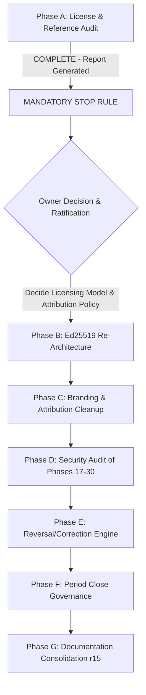

# AUDIT A: LICENSE, DEPENDENCY & REFERENCE AUDIT REPORT
**Document Reference:** `docs/audits/AUDIT_A_LICENSE_AND_REFERENCES.md`  
**Execution Date:** 2026-10-27  
**Auditor Roles:** Software/Systems Architect, Senior Backend Engineer, Senior Accountant, Legal/Compliance Reviewer  
**Scope:** Repository Root (`C:\Projects\HesaBora`), Branch: `dakhl-foundation`  
**Status:** COMPLETE — MANDATORY STOP RULE TRIGGERED (Phase A Report Ready for Owner Ratification)

---

## 1. EXECUTIVE SUMMARY & CRITICAL LEGAL STOP-GATE

> [!CAUTION]
> **CRITICAL LEGAL CONFLICT IDENTIFIED (Mandatory Stop Rule Triggered):**  
> 1. The repository root contains `LICENSE` (674 lines), which is the **GNU General Public License Version 3 (GPL-3.0)**, committed in the repository's initial root commit (`9e4dbce37258176980f46db31345475f5d48ebcb` on 2024-03-07 by Hadi <hadi60@gmail.com>).
> 2. The upstream repository (`https://github.com/Jooyeshgar/FreeAmir.git`) from which this application is forked/derived is licensed under **GPL-3.0** with contributions from at least 23 distinct contributors.
> 3. Two foundational Composer packages are copyleft:
>    - `jooyeshgar/moadian` (v3.0.0): **GPL-3.0**
>    - `mpdf/mpdf` (v8.3.1): **GPL-2.0-only**
> 4. `app/Helpers/jdf.php` is licensed under **GNU LGPL** by Reza Gholampanahi.
> 
> **The Legal Reality:** Under GPLv3 (Section 6 & Section 10), any derivative work based on GPL code that is conveyed/distributed to clients must also be made available under GPL-3.0 with full source code. Imposing technological license restrictions (such as node-locked Ed25519/HMAC license keys, obfuscation, or proprietary anti-tamper mechanisms) or claiming exclusive proprietary ownership ("تمامی حقوق مادی و معنوی و کدهای منبع منحصراً متعلق به...") directly breaches the GNU GPLv3 license terms of the upstream codebase and its dependencies.
> 
> **Engineering Decision:** As dictated by the prompt's explicit operating rules, **we do NOT modify any code in Phase A**. We present this audit report and request owner guidance before proceeding to Phase B (Ed25519) and Phase C (Branding cleanup).

---

## 2. SECTION A1: UPSTREAM LICENSING FACTS & DEPENDENCY INVENTORY

### 2.1 Repository Origin & Initial Git Commits
| Fact / Artifact | Git Evidence / File Reference | Content & Details |
|---|---|---|
| **Initial Root Commit** | Commit `9e4dbce37258176980f46db31345475f5d48ebcb` (2024-03-07 11:52:00 +0330) by `Hadi <hadi60@gmail.com>` | Added `.gitignore` (23 lines) and `LICENSE` (674 lines). |
| **Root License File** | `LICENSE` (lines 1–674) | **GNU General Public License Version 3 (GPL-3.0)**. Lines 669–670 explicitly state: *"The GNU General Public License does not permit incorporating your program into proprietary programs."* |
| **Second Commit** | Commit `e1e9230c0de64bfb79fc2c5807f795c3d9a4243f` (2024-03-07 11:56:26 +0330) by `Hadi <hadi60@gmail.com>` | Added `README.md`. Contradictorily stated: *"This project is licensed under the MIT License. See the LICENSE: LICENSE file for details."* (while `LICENSE` was GPLv3). |
| **Third Commit** | Commit `7816c03a652a22662e329489fec0e61ebedb7889` (2024-03-07 12:44:21 +0330) by `Hadi <hadi60@gmail.com>` | Added Laravel 10 skeleton. `composer.json` retained default skeleton: `"name": "laravel/laravel"`, `"license": "MIT"`. |
| **Git Remotes** | `git remote -v` | `origin: https://github.com/hadibehnampour0-sketch/HesaBora.git`<br>`upstream: https://github.com/Jooyeshgar/FreeAmir.git` |
| **Git Authorship** | 23 distinct authors across history | Includes `Hadi <Hadi60@gmail.com>`, `aionui@jooyeshgar.com`, `bandi@jooyeshgar.com`, `Daniyal <dnaliyari@jooyeshgar.com>`, `Hesam`, `Iman`, `Pooya Fallah`, `Yasin`, `Yousha Aleayoub`, etc. |

---

### 2.2 Complete Dependency License Matrix (Composer & NPM)

#### Composer Runtime Dependencies (`composer.json`)
| Package Name | Version | License | License Category | Risk / Obligations |
|---|---|---|---|---|
| `jooyeshgar/moadian` | `V3.0.0` | **GPL-3.0** | **Strong Copyleft** | Requires derivative works to remain GPL-3.0. Source code must be provided upon request. |
| `carlos-meneses/laravel-mpdf` | `2.1.13` | MIT | Permissive | Wrapper for `mpdf/mpdf`. |
| `mpdf/mpdf` (transitive) | `v8.3.1` | **GPL-2.0-only** | **Strong Copyleft** | PDF generation engine. GPL-2.0 copyleft obligations apply. |
| `nativephp/desktop` | `2.2.1` | MIT | Permissive | Native desktop application shell. |
| `nativephp/php-bin` (transitive) | `1.2.0` | **Apache-2.0, GPL-3.0-or-later, MIT, PHP-3.01** | Multi-license | Bundled PHP runtime binaries. |
| `dedoc/scramble` | `v0.13.45` | MIT | Permissive | OpenAPI documentation generator. |
| `spatie/laravel-permission` | `6.25.0` | MIT | Permissive | Role-based authorization & multi-tenant teams. |
| `spatie/laravel-activitylog` | `4.12.3` | MIT | Permissive | Audit logging. |
| `laravel/framework` | `12.62.0` | MIT | Permissive | Core backend runtime. |
| `laravel/sanctum` | `4.3.2` | MIT | Permissive | API token authentication. |
| `laravel/tinker` | `2.11.1` | MIT | Permissive | REPL shell. |
| `doctrine/dbal` | `3.10.5` | MIT | Permissive | Database schema introspection. |
| `guzzlehttp/guzzle` | `7.15.5` | MIT | Permissive | HTTP client for external integrations. |
| `fakerphp/faker` | `1.24.1` | MIT | Permissive | Testing data generator. |
| `kasraghoreyshi/persian-faker` | `1.04` | MIT | Permissive | Iranian localization test generator. |
| `lab404/laravel-impersonate` | `1.7.8` | MIT | Permissive | Admin user impersonation. |
| `barryvdh/laravel-debugbar` | `v3.16.5` | MIT | Permissive | Local debugging tool. |

#### Internal Helper Libraries & Bundled Fonts
| Component | Path / Source | Declared License | Author / Copyright Holder | Obligations |
|---|---|---|---|---|
| `jdf.php` (Jalali Date Helper) | `app/Helpers/jdf.php` line 7 | **GNU LGPL** (Open Source & Free) | Reza Gholampanahi (`http://jdf.scr.ir`) | LGPL allows linking, but source of the helper must remain open, and modifications must be shared under LGPL. |
| `Vazirmatn` Font Suite | `resources/fonts/vazirmatn/OFL.txt` | **SIL Open Font License 1.1 (OFL-1.1)** | Saber Rastikerdar (`https://github.com/rastikerdar/vazirmatn`) | Requires retaining copyright notice in distributed font files. Cannot sell font by itself. |
| `Sahel` Font Suite | `resources/fonts/Sahel*.ttf` | **SIL Open Font License 1.1 (OFL-1.1)** | Saber Rastikerdar | Requires retaining OFL copyright notice. |

#### NPM Frontend Dependencies (`package.json`)
| Package Name | Version | License | Obligations |
|---|---|---|---|
| `alpinejs` | `3.15.8` | MIT | Permissive — retain notice. |
| `@majidh1/jalalidatepicker` | `0.9.12` | MIT | Permissive — retain notice. |
| `chart.js` | `4.5.1` | MIT | Permissive — retain notice. |
| `chartjs-plugin-datalabels` | `2.2.0` | MIT | Permissive — retain notice. |
| `daisyui` | `5.5.19` | MIT | Permissive — retain notice. |
| `tailwindcss` | `4.2.4` | MIT | Permissive — retain notice. |
| `vite` | `7.3.5` | MIT | Permissive — retain notice. |
| `axios` | `1.20.0` | MIT | Permissive — retain notice. |

---

## 3. SECTION A2: REFERENCE INVENTORY

Comprehensive scan of all non-vendor/non-worktree files across the repository for historical and attribution terms.

### 3.1 Term Occurrence Summary Across Codebase
| Search Term | Total Occurrences | Key Directories Affected |
|---|---|---|
| `freeamir` / `FreeAmir` | **175** | `resources/` (27), `docker/` (27), `docs/` (70), `app/` (6), `tests/` (7), `.env.example` (5), `README*` (10) |
| `amir` / `Amir` | **461** | `docs/` (151), `resources/` (80), `app/` (72), `tests/` (70), `docker/` (27), `database/` (15), `script/` (7) |
| `امیر` (Persian) | **104** | `docs/` (102), `AGENTS.md` (1), `lang/` (1) |
| `jooyeshgar` / `Jooyeshgar` | **73** | `docs/` (32), `app/` (5), `tests/` (5), `bootstrap/` (4), `README*` (8), `.env.example` (4), `composer.json` (1) |
| `base heritage` | **6** | `docs/` (5), `AGENTS.md` (1) |
| `upstream` | **32** | `docs/` (27), `AGENTS.md` (3), `app/` (1), `tests/` (1) |
| `fork` | **34** | `docs/` (28), `nativephp/` (4), `AGENTS.md` (1), `README.en.md` (1) |
| `derived from` | **20** | `docs/` (13), `app/` (4), `tests/` (2), `AGENTS.md` (1) |
| `exclusive` | **30** | `docs/` (16), `LICENSE` (3), `AGENTS.md` (3), `database/` (2), `lang/` (1), `tests/` (4) |
| `copyright` | **49** | `LICENSE` (31), `resources/` (12), `docs/` (2), `config/` (2), `.env.example` (1) |
| `©` | **4** | `resources/views/` (4: About page, password reset, account verification, report export email) |

---

### 3.2 Granular Breakdown by Layer

#### Layer 1: Application Logic & Configuration (`app/`, `config/`, `bootstrap/`)
1. **Runtime Config Store (`config('amir.*')`):**
   - In `app/Http/Middleware/ConfigLoader.php:43`: Reads `configs` table and sets `config(['amir.'.$config->key => $config->value])`.
   - Used in **62 distinct call sites** across `app/Services/` and `app/Http/Controllers/` (e.g. `config('amir.bank')`, `config('amir.cash_book')`, `config('amir.currency')`, `config('amir.sell_vat')`).
2. **File & Class Naming:**
   - `app/Services/DocumentImportExport/FreeAmirImportFormat.php` (lines 11, 65, 70, 243).
   - `app/Services/DocumentImportExport/DocumentImportExportService.php` (lines 18, 20, 160).
   - `app/Services/DocumentImportExport/DocumentImportFormatRegistry.php` (line 11).
   - `app/Http/Controllers/BackupController.php:66`: `$fileBaseName = "Amir-{$safeName}-".now()->format('Y-m-d-H-i');`.
3. **Environment & NativePHP Configuration:**
   - `config/nativephp.php:44`: `'description' => env('NATIVEPHP_APP_DESCRIPTION', 'Dakhl — Free Laravel Accounting Software')`.
   - `.env.example` lines 72, 77, 78, 83–86:
     ```env
     NATIVEPHP_APP_AUTHOR="Jooyeshgar"
     GITHUB_OWNER=Jooyeshgar
     GITHUB_REPO=FreeAmir
     DEPLOY_SERVER=freeamir
     DEPLOY_REPOSITORY=git@github.com:Jooyeshgar/FreeAmir.git
     DEPLOY_PATH=/home/freeamir/
     DEPLOY_HEALTH_CHECK=https://develop.freeamir.com
     ```

#### Layer 2: User Interface & Localization (`resources/`, `lang/`)
1. **Frontend Styling & Scripts:**
   - `resources/css/app.css` (lines 444–463): 8 CSS variables named `--freeamir-control-focus-color` and `--freeamir-control-focus-shadow`.
   - `resources/js/app.js` (lines 34–35): `window.getFreeAmirChartTheme` and `window.applyFreeAmirChartTheme`.
   - 9 Blade chart components referencing `window.getFreeAmirChartTheme`:
     `account-balance.blade.php`, `bar-chart.blade.php`, `cash-balance-chart.blade.php`, `item-comparison-pie.blade.php`, `line-chart.blade.php`, `monthly-budget-comparison.blade.php`, `pie-chart.blade.php`, `crm/dashboard.blade.php`, `warehouse/dashboard.blade.php`.
2. **Authentication & Footer Links:**
   - `resources/views/auth/partials/footer.blade.php` (lines 3, 6, 9): Direct links to `https://github.com/Jooyeshgar/FreeAmir?tab=GPL-3.0-1-ov-file` and `https://github.com/Jooyeshgar/FreeAmir/issues`.
3. **About Page & Claims of Exclusive Ownership:**
   - `resources/views/about.blade.php` (lines 1, 7, 32): References `about.about_freeamir`.
   - `lang/fa/about.php` lines 24–28:
     ```php
     'license' => 'حقوق مالکیت و مجوز انتشار',
     'license_title' => 'مجوز انحصاری و حق نشر',
     'license_text' => 'تمامی حقوق مادی، معنوی، طراحی، معماری و کدهای منبع سامانه دخل متعلق به هادی بهنام‌پور می‌باشد. هرگونه بهره‌برداری تجاری، بازنشر، توسعه و استقرار این نرم‌افزار منحصراً تحت نظارت و با مجوز مستقیم هادی بهنام‌پور مجاز است.',
     'developed_by' => 'صاحب امتیاز و مدیر توسعه',
     'developer_name' => 'هادی بهنام‌پور',
     ```
   - `lang/en/about.php` lines 24–28: Identical claim in English ("All intellectual, economic, and moral rights, source code architecture, and software design of Dakhl belong to Hadi Behnampour...").

#### Layer 3: Documentation & Decision Log (`docs/`, `AGENTS.md`)
1. **AGENTS.md:** Lines 4–5 describe FreeAmir as base heritage; line 287 mentions Super-Admin exclusive permissions.
2. **README.md & README.en.md:**
   - Mentions GPL-3 license in FAQ and footer.
   - Contains Jooyeshgar GitHub release URLs (`https://github.com/Jooyeshgar/FreeAmir/releases/`) and Docker image tags (`ghcr.io/jooyeshgar/freeamir-all-in-one:latest`).
3. **Master Context & Decision Log (`Dakhl_MASTER_CONTEXT...`, `Dakhl_DECISION_LOG...`):**
   - Decision **D-001**: "Dakhl is the product brand; FreeAmir is upstream/base only."
   - Decision **D-052**: "FreeAmir upstream diff — periodically diff HEAD against `Jooyeshgar/FreeAmir` (GPL-3.0)."
   - Decision **D-054**: Purged HesaBora name to Dakhl.

---

## 4. SECTION A3: LICENSING CODE INVENTORY & ARCHITECTURE MAP

### 4.1 Current Implementation Overview
The current licensing subsystem was added in Phase 16 / Phase 21 (`database/migrations/2026_10_21_130000_create_licenses_table.php`).

| File | Component | Role & Functionality |
|---|---|---|
| `app/Services/LicenseService.php` | Core Domain Service | Generates machine fingerprint, issues/verifies licenses via HMAC-SHA256, checks module entitlements, auto-provisions 14-day trials, stores plan catalogs. |
| `app/Http/Controllers/LicenseController.php` | Web Controller | Handles `/management/license` views, manual license activation, and contains **in-app demo & custom license key generators**. |
| `app/Http/Middleware/EnsureModuleLicensed.php` | HTTP Middleware | Intercepts requests for gated modules via `licensed:{module_key}` and redirects or returns 403 JSON if not entitled. |
| `app/Models/License.php` | Eloquent Model | Represents rows in `licenses` table with JSON `modules` column, hardware fingerprint, grace period, and expiration timestamps. |
| `app/Providers/AppServiceProvider.php` | Blade Hook | Registers Blade directive `@licensed($module)`. |
| `tests/Feature/ModularLicensingTest.php` | Feature Test Suite | 424 lines, verifies HMAC verification, tamper detection, trial auto-provisioning, module checks, and company limits. |

### 4.2 Security Analysis of Current V1 Licensing
1. **Symmetric HMAC Signing Flaw:**
   - Token structure: `DAKHL-LIC-v1.{base64url(payload)}.{signature}`
   - Signature: `hash_hmac('sha256', $payloadBase64, $secret)`
   - The signing secret is resolved via `LicenseService::getSecretKey()`:
     ```php
     return config('app.license_secret', config('app.key', 'dakhl-offline-secret-default-key')).':dakhl-lic-auth-v1';
     ```
   - **Critical Vulnerability:** Because HMAC is symmetric, the verifying client must possess the exact secret key used to sign. Since PHP code is readable and distributed to clients, any user can extract `APP_KEY` and mint unlimited lifetime licenses.
2. **In-App Demo Key Generator:**
   - `LicenseController::generateDemo()` and `LicenseController::generateCustom()` allow generating valid, signed license keys directly from the browser UI if `access-super-admin-panel` or `local`/`testing` environment is set.
3. **Machine Fingerprint Generation:**
   - Implemented in `LicenseService::generateMachineFingerprint()`:
     Combines OS name, hostname, machine architecture, OS family, and `COMPUTERNAME`/`machine-id` using SHA-256 formatted as `DAKHL-XXXX-XXXX-XXXX-XXXX`.

---

## 5. SECTION A4: PREVIOUSLY-FREE CAPABILITY INVENTORY ("NEVER RE-GATE")

### 5.1 Historical Capabilities (Working Before Licensing Layer)
The following capabilities were fully functional and unrestricted from the earliest stages of FreeAmir/Dakhl:

1. **Double-Entry Bookkeeping Core:** Journal entries, General Ledger (دفتر کل), Subsidiary Ledger (دفتر معین), Detailed Ledger (تفصیلی), Trial Balance (تراز آزمایشی ۴ و ۸ ستونی), Opening/Closing balance documents (سند افتتاحیه و اختتامیه).
2. **Invoicing & Commerce:** Sales invoices (فاکتور فروش), Purchase invoices (فاکتور خرید), Sales returns (برگشت از فروش), Purchase returns (برگشت از خرید), Quotations/Proformas (پیش‌فاکتور), Waste invoices (فاکتور ضایعات), Ancillary purchase costs (هزینه‌های جانبی خرید).
3. **Warehouse & Multi-Warehouse Inventory:** Multi-warehouse storage, Warehouse transfers (حواله و رسید انبار), Product stock ledger (کاردکس کالا), Weighted-average cost calculation (بهای تمام‌شده میانگین موزون), Physical cycle counting & inventory reconciliation (انبارگردانی).
4. **Treasury & Cheque Management:** Complete 7-stage Iranian Sayad cheque lifecycle (دریافت، ثبت صیادی، واگذاری به بانک، وصول، برگشت، عودت، ابطال، ضمانت), Cash books (صندوق‌ها), Bank accounts (حساب‌های بانکی), Bank reconciliation (مغایرت‌گیری بانکی).
5. **Tax & Moadian E-Invoicing (`jooyeshgar/moadian`):**
   - Direct electronic invoice dispatch to the Iranian Tax Administration (سامانه مودیان سازمان امور مالیاتی).
   - Cryptographic signing with private fiscal keys, tax memory client ID, and SSTID mapping.
   - Invoice inquiry and status tracking from the tax authority.
   - Seasonal VAT reports (ارزش افزوده ماده ۱۰) and tax calculation.
6. **Multi-Company & Fiscal Periods:** Multiple companies, separate fiscal years, year-end fiscal transfer wizard.
7. **Human Resources & Attendance:** Personnel profiles, clock in/out tracking, payroll slips.

### 5.2 The "Re-Gating" Regression in Current Plan Tiers
In `LicenseService::getAllPlans()`, the current catalog specifies:
- **نسخه برنزی (Basic - ۳,۹۰۰,۰۰۰ ریال):**
  Includes: `core_accounting`, `sales_purchase`, `inventory_warehouse`, `cheques_treasury`.  
  **Omitted:** `tax_moadian` (سامانه مودیان و مالیات فصلی)!
- **نسخه نقره‌ای (Professional - ۹,۵۰۰,۰۰۰ ریال):**
  Added: `tax_moadian`, `pos_retail`, `customer_loyalty`, `sms_automation`, etc.

**Violation of Master Context §39.6 & D-026:**
In Iran, Moadian e-invoicing is a mandatory legal compliance requirement for small shopkeepers and corporations alike. It was previously completely open and working in the base project. Moving `tax_moadian` exclusively to the higher-priced "Professional" plan constitutes retroactive re-gating of an essential, pre-existing compliance feature.

---

## 6. FINDINGS & REQUIRED ACTIONS FOR THE PROJECT OWNER

### 6.1 Finding 1: Copyleft Obligations vs. Commercial Licensing Model
- **Fact:** Root `LICENSE` is GPL-3.0. Upstream repository is GPL-3.0. Core dependency `jooyeshgar/moadian` is GPL-3.0. Dependency `mpdf` is GPL-2.0.
- **Conflict:** A closed-source model relying on cryptographic node-locking (whether HMAC or Ed25519) to prevent users from running, modifying, or redistributing software on their own servers or computers contradicts GPL-3.0 Section 6 and Section 10.
- **Permissible Commercial Paths Under GPL:**
  1. **Dual-Licensing (if Hadi Behnampour owned 100% of the copyright):** Not possible here because 23 outside contributors from Jooyeshgar and the community authored significant portions of the base code under GPL.
  2. **Open-Core / SaaS / Services Model:** Keep the accounting core open under GPLv3, while commercializing hosted cloud sync, managed marketplace bridges (e.g. Digikala/WooCommerce cloud gateways), automated tax filing services, SMS gateways, and official support/updates.
  3. **Proprietary Add-On Plugins via Independent Network Services:** Modules that run as separate network services (e.g., cloud AI Copilot, external market quote aggregators) can have their own commercial terms, provided they do not link statically into the GPL PHP core.

### 6.2 Finding 2: Exclusive Ownership Claims in UI & Lang Files
- **Fact:** `lang/fa/about.php` and `lang/en/about.php` state that all intellectual and moral rights, source code architecture, and software design belong exclusively to Hadi Behnampour.
- **Action Required:** This must be revised to an accurate, legally sound formulation such as:
  *"نرم‌افزار حسابداری و مدیریت کسب‌وکار دخل — توسعه و بومی‌سازی توسط هادی بهنام‌پور. تمامی حقوق برای مشارکت‌ها و توسعه‌های اختصاصی دخل محفوظ است."*
  Open source notices for upstream FreeAmir, Jooyeshgar Moadian, mPDF, and Vazirmatn must be accessible in a standard `THIRD_PARTY_NOTICES.md` file without claiming third-party code as exclusive property.

### 6.3 Finding 3: Cryptographic Re-Architecture (Phase B - Ed25519)
- Once the business/licensing stance is confirmed by the owner, Phase B replaces symmetric HMAC with asymmetric **Ed25519 (libsodium)**:
  - App ships with **Public Verification Key only**.
  - Private signing key is kept strictly in an external offline CLI issuer (`tools/license-issuer/`).
  - NativePHP Windows runtime libsodium extension availability verified.
  - In-app demo key generator removed from production builds.

### 6.4 Finding 4: Re-Enfranchising Moadian in Basic Tier ("Never Re-Gate")
- In Phase B/C, `LicenseService::getAllPlans()` must be updated so that `tax_moadian` is included in the `basic` (برنزی) tier alongside core accounting, invoicing, inventory, and cheques.

---

## 7. STOP-GATE STATUS & NEXT STEPS



**Current Action:** Phase A is finished with zero code modifications. We pause here to present this audit report to the owner. Awaiting owner instructions on licensing direction to proceed with Phase B and Phase C.
