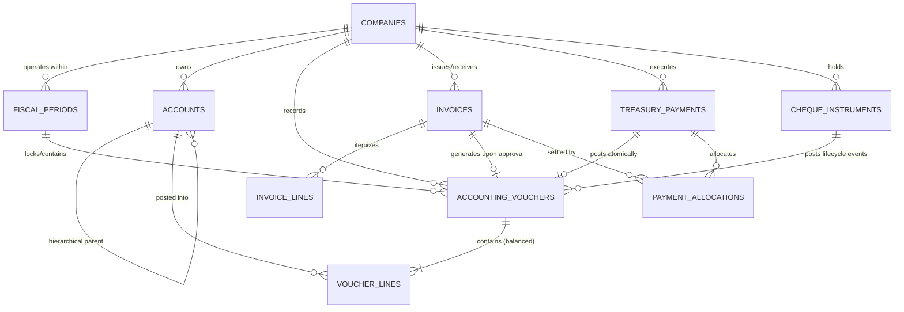
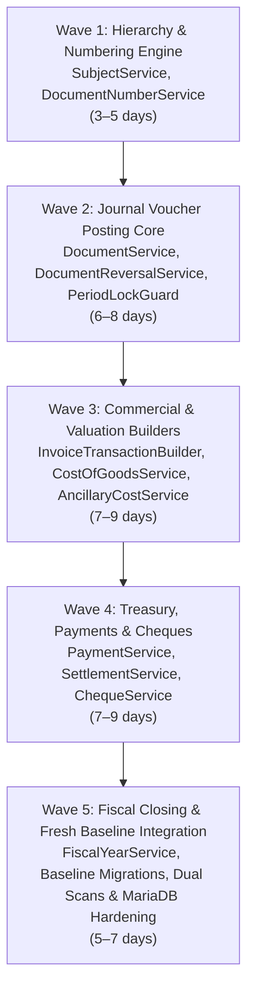

# Dakhl Clean-Room Core Rewrite Plan (Option B Architecture)

**Document Reference:** `docs/cleanroom/CORE_REWRITE_PLAN.md`  
**Governing Decision:** `D-130 — Clean-Room Core Rewrite, Fresh Dakhl Schema Baseline, and UX View Rebuild Architecture`  
**Status:** DRAFT PROPOSAL FOR OWNER APPROVAL — NO REWRITE YET STARTED  
**Target Milestone:** Dakhl Clean-Room Protected-Core Replacement  
**Date:** 2026-10-29  

---

## 1. Executive Summary & Strategic Rationale

Pursuant to Decision **D-130** (approving **Option B** from `docs/cleanroom/STATUS.md`), Dakhl resolves all legacy GPL contamination through a surgical, three-pillar modernization program:

1. **Clean-Room Core Accounting Rewrite:** The ~16 protected-core services, transaction builders, and financial lifecycles are rewritten from scratch via an isolated "fresh-session" clean-room protocol, guided strictly by sanitized behavioral specifications and black-box tests.
2. **UX Modernization for Views:** Rather than mechanically rewriting 310 legacy FreeAmir Blade views (which are tightly coupled to obsolete UX patterns), views are systematically superseded by the new Persian-first Dakhl desktop interface (Tailwind CSS, DaisyUI, Alpine.js).
3. **Fresh Dakhl-Owned Schema Baseline:** The database schema is redesigned from first principles. Because Dakhl is pre-release software with zero production installations or historical client data, legacy backward-compatibility migrations are eliminated. The new schema provides strict relational constraints, explicit debit/credit accounting columns, UUID synchronization keys, and immutable audit trails.

> [!IMPORTANT]
> **Owner Release Gate:** In strict accordance with AGENTS.md Guardrail 5, no closed-source build, installer, or release may be distributed before CR-7 is completed and the Owner Release Gate is formally executed.

---

## 2. Inventory of the 16 Protected-Core Units

The core accounting engine consists of 16 interconnected services and transaction builders that govern ledger integrity, financial lifecycles, and posting immutability:

| # | Protected-Core Class | Relative Path | Primary Architectural Responsibility | Risk Level |
|---|---|---|---|:---:|
| 1 | `DocumentService` | `app/Services/DocumentService.php` | Universal double-entry journal posting choke-point; enforces document numbering, status transitions, and balanced postings. | **CRITICAL** |
| 2 | `DocumentReversalService` | `app/Services/DocumentReversalService.php` | Implements audit reversals (D-127) for posted documents; enforces closed-period permissions and reversal provenance. | **CRITICAL** |
| 3 | `InvoiceTransactionBuilder` | `app/Services/InvoiceTransactionBuilder.php` | Compiles multi-line invoice journals (sales, purchases, returns, discounts, tax/VAT, rounding, and COGS offsets). | **CRITICAL** |
| 4 | `InvoiceService` | `app/Services/InvoiceService.php` | Invoice status lifecycle (draft $\to$ approved $\to$ rejected $\to$ paid); enforces financial immutability boundary (D-086–D-089). | **CRITICAL** |
| 5 | `CostOfGoodsService` | `app/Services/CostOfGoodsService.php` | Inventory valuation engine; calculates weighted-average unit costs and perpetual inventory cost-of-goods postings. | **HIGH** |
| 6 | `PaymentService` | `app/Services/PaymentService.php` | Atomic cash/bank/card payment voucher creation; enforces financial event UUID identity (D-078/D-079) and immutability (D-084). | **CRITICAL** |
| 7 | `SettlementService` | `app/Services/SettlementService.php` | Invoice installment settlements, payment allocation lifecycles, and capacity validations (D-070/D-081). | **HIGH** |
| 8 | `ChequeService` | `app/Services/ChequeService.php` | Independent 8-state cheque instrument state machine (register, deposit, clear, bounce, endorse, return, cancel, guarantee) (D-070). | **CRITICAL** |
| 9 | `FiscalYearService` | `app/Services/FiscalYearService.php` | Fiscal year closing, closing/opening voucher generation, profit/loss rollup, and baseline import/export provenance (D-085). | **CRITICAL** |
| 10 | `SubjectService` | `app/Services/SubjectService.php` | Chart of Accounts hierarchy management (Root $\to$ Moeen $\to$ Tafsili); validates accounting nature and balance sheet permanence. | **HIGH** |
| 11 | `AncillaryCostService` | `app/Services/AncillaryCostService.php` | Inbound commercial shipping, customs, and ancillary costs capitalization on purchase invoices. | **MEDIUM** |
| 12 | `AncillaryCostTransactionBuilder` | `app/Services/AncillaryCostTransactionBuilder.php` | Constructs double-entry journals capitalizing landed ancillary costs into inventory valuations. | **MEDIUM** |
| 13 | `FixedAssetService` | `app/Services/FixedAssetService.php` | Fixed asset registration, depreciation schedules, and automated periodic depreciation journal postings. | **MEDIUM** |
| 14 | `GroupActionService` | `app/Services/GroupActionService.php` | Batch recalculation pipelines, dependency recycling, and non-financial COGS chaining (D-087). | **HIGH** |
| 15 | `PeriodLockGuard` | `app/Services/FinancialAudit/PeriodLockGuard.php` | Statutory freeze enforcement across the 5-state fiscal lifecycle (`OPEN`, `REVIEW`, `RECONCILED`, `CLOSED`, `LOCKED`) (D-128). | **CRITICAL** |
| 16 | `DocumentNumberService` | `app/Services/DocumentNumberService.php` | Atomic sequential document numbering, concurrency locking, and device range leases (D-075). | **HIGH** |

---

## 3. Mandatory Non-Negotiable Invariants & Guardrails

Every clean-room replacement must mathematically satisfy and rigorously enforce the following seven core invariants:

```
                      ┌────────────────────────────────────────┐
                      │        ACCOUNTING INVARIANTS           │
                      └───────────────────┬────────────────────┘
                                          │
         ┌────────────────────────────────┼────────────────────────────────┐
         │                                │                                │
┌────────┴────────┐              ┌────────┴────────┐              ┌────────┴────────┐
│ 1. Balance Net  │              │ 2. Immutability │              │ 3. Period Lock  │
│  SUM(value) = 0 │              │  D-084/D-086/89 │              │  5-State Freeze │
└─────────────────┘              └─────────────────┘              └─────────────────┘
         │                                │                                │
┌────────┴────────┐              ┌────────┴────────┐              ┌────────┴────────┐
│ 4. Provenance   │              │ 5. Multi-Tenant │              │ 6. Audit Trail  │
│  NATIVE/BASELINE│              │  Company Scope  │              │  Reversals Only │
└─────────────────┘              └─────────────────┘              └─────────────────┘
```

### Invariant 1: Double-Entry Mathematical Balance
Every accounting document must strictly balance debits and credits:
$$\sum \text{Debit} = \sum \text{Credit} \iff \sum_{i=1}^{n} \text{transactions.value}_i = 0$$
Unbalanced documents must be unconditionally rejected at the service/builder boundary. Partial or unbalanced documents must never reach the database.

### Invariant 2: Multi-Tenancy & Fiscal Isolation
All accounts, documents, invoices, cheques, and inventory records are strictly scoped by `company_id` and `fiscal_year_id`. Cross-tenant data leakage is prevented via global scopes (`FiscalYearScope`) and validated in FormRequests and transaction builders.

### Invariant 3: Posted Record Immutability (D-084, D-086, D-087, D-089)
Once a document, invoice, payment, or payment allocation has completed financial posting or has active financial attachments (`Payment` or `PaymentAllocation`), it is immutable:
- Destructive edits (`updateInvoice`) are blocked (D-086).
- Unapprovals (`unapproveInvoice`) are blocked (D-087).
- Re-approvals (`userFacingApproveInvoice`) are blocked (D-088).
- Direct rejections (`userFacingRejectInvoice`) are blocked (D-089).
- Hard deletions (`deletePayment`, `removeAllocation`, `deleteInvoice`) are unconditionally blocked (D-084).

### Invariant 4: Audit Trail & Provenance (D-085)
Every financial record carries immutable provenance:
- `FinancialProvenance::NATIVE`: Created directly by user operations.
- `FinancialProvenance::BASELINE`: Imported or copied from a prior fiscal year.
- `FinancialProvenance::REVERSAL`: Automatically generated accounting reversal (D-127).

### Invariant 5: Fiscal Period Freeze (D-128)
The fiscal year follows an auditable 5-state lifecycle:
$$\text{OPEN} \longrightarrow \text{REVIEW} \longrightarrow \text{RECONCILED} \longrightarrow \text{CLOSED} \longrightarrow \text{LOCKED}$$
All mutation attempts in `CLOSED` or `LOCKED` periods are blocked by `PeriodLockGuard`. Adjustments in `CLOSED` periods require elevated permissions and audit reasons; `LOCKED` periods are strictly immutable.

### Invariant 6: Official Audit Reversals over Deletion (D-127)
Erroneous posted transactions must never be deleted or silently edited. Correction must follow the official accounting audit trail: generating a dedicated reversing voucher (`is_reversal = true`) that negates the original postings, linked by `reversed_document_id`.

### Invariant 7: Exactly-Once Financial Event Identity (D-078, D-079)
Payments and financial events carry an immutable `financial_event_uuid`, identifying the economic event independently of retry attempts (`operation_id`). Re-submitting the same economic event is strictly idempotent.

---

## 4. Public Interfaces & Type Contracts to Preserve

To ensure seamless integration with the existing controller layer, queued jobs, and frontend APIs, the rewritten services must maintain the following core public contracts:

```php
namespace App\Contracts\Accounting;

interface DocumentServiceInterface
{
    public static function createDocument(User $user, array $headerData, array $transactionLines): Document;
    public static function updateDocument(Document $document, User $user, array $headerData, array $transactionLines): Document;
    public static function changeDocumentStatus(Document $document, User $user, string $status): Document;
}

interface InvoiceTransactionBuilderInterface
{
    public static function build(Invoice $invoice, array $context = []): array;
}

interface PaymentServiceInterface
{
    public function createPayment(User $user, array $attributes): Payment;
    public function createCreditPayment(User $user, array $attributes): Payment;
    public function allocatePayment(Payment $payment, Invoice $invoice, float $amount): PaymentAllocation;
}

interface ChequeServiceInterface
{
    public function registerCheque(User $user, array $attributes): Cheque;
    public function depositCheque(Cheque $cheque, int $bankAccountId): Cheque;
    public function clearCheque(Cheque $cheque): Cheque;
    public function bounceCheque(Cheque $cheque, string $reason): Cheque;
    public function endorseCheque(Cheque $cheque, int $recipientId): Cheque;
    public function returnCheque(Cheque $cheque): Cheque;
    public function cancelCheque(Cheque $cheque): Cheque;
}
```

---

## 5. New Dakhl Baseline Schema Redesign Proposal

### 5.1 Architecture Principles
1. **Explicit Debit / Credit Columns:** Moving away from signed `value` floats toward explicit `debit_amount` and `credit_amount` decimal columns (`DECIMAL(18, 4)`), satisfying international accounting audit standards and preventing sign-flipping bugs.
2. **UUID Primary & Secondary Keys:** All financial aggregate roots carry canonical `uuid` keys for offline/online synchronization (D-071/D-078).
3. **Engine-Level Relational Integrity:** Enforcing `ON DELETE RESTRICT` on all foreign keys referencing posted transactions, accounts, and companies.
4. **Clean Domain Terminology:** Replacing ambiguous upstream names with standard accounting terms:
   - `documents` $\to$ `accounting_vouchers`
   - `transactions` $\to$ `voucher_lines`
   - `subjects` $\to$ `accounts`
   - `cheques` $\to$ `cheque_instruments`
   - `payments` $\to$ `treasury_payments`

### 5.2 Target Dakhl Baseline Schema (Quarantine & Clean-Room Rule)

> [!IMPORTANT]
> **Clean-Room Isolation Rule for Database Schema:**  
> The old-to-new mapping table contains derived legacy structures and is strictly quarantined in `docs/cleanroom/RESTRICTED_UPSTREAM_MAPPING.md`.  
> In accordance with CR-3 governance, **Implementer sessions must never receive `RESTRICTED_UPSTREAM_MAPPING.md` or any legacy schema definitions**.  
> The Implementer receives **EXCLUSIVELY** the new target Dakhl schema definition, sanitized behavioral specifications, and black-box tests.

#### Target Dakhl Baseline Schema Summary
- **`companies`**: Multi-tenant company context and configuration.
- **`fiscal_periods`**: 5-state fiscal calendar cycles (`OPEN`, `REVIEW`, `RECONCILED`, `CLOSED`, `LOCKED`).
- **`accounts`**: 3-tier Chart of Accounts (Root $\to$ Moeen $\to$ Tafsili), financial balance nature (`debtor`/`creditor`), and permanence flag.
- **`accounting_vouchers`**: Universal double-entry journal vouchers with immutable numbers, posting provenance (`native`, `baseline`, `reversal`), and sync UUID.
- **`voucher_lines`**: Journal lines with explicit non-negative `debit_amount` and `credit_amount` (`DECIMAL(18, 4)`), target `account_id`, and foreign key constraint (`ON DELETE RESTRICT`).
- **`invoices` & `invoice_lines`**: Commercial sales, purchases, and return invoices with sequential leasing (D-075) and mutation boundary enforcement (D-086–D-089).
- **`treasury_payments`**: Cash, bank, and electronic payments carrying canonical `financial_event_uuid` (D-078/D-079) and posting immutability (D-084).
- **`payment_allocations`**: Invoice settlement allocation records linking payments to invoice installments (D-081).
- **`cheque_instruments`**: Independent 8-state commercial paper instrument register (D-070).

---

### 5.3 Mermaid Schema Relationship Diagram



---

### 5.4 Schema Decision ADR Proposals (Submitted for Owner Approval)

To avoid ad-hoc design decisions during the core rewrite, four fundamental schema questions are structured as formal Architecture Decision Records (ADRs) for explicit Owner sign-off:

#### ADR Proposal A: Signed Single `value` vs Explicit Dual `debit_amount` / `credit_amount`
- **Context:** Upstream FreeAmir stored transaction amounts in a single signed `value` column (positive for debit, negative for credit). While mathematically compact ($\sum \text{value} = 0$), signed storage creates subtle sign-flipping bugs in queries, complicates financial statements (trial balances, balance sheets), and conflicts with standard accounting audit trails.
- **Option 1 (Recommended): Explicit Dual Columns (`debit_amount`, `credit_amount` `DECIMAL(18, 4) UNSIGNED DEFAULT 0.0000`).**
  - *Pros:* Fully standard in ERP/accounting software; balance invariant is $\sum \text{debit} = \sum \text{credit}$; database CHECK constraint `(debit_amount = 0 OR credit_amount = 0)` prevents conflicting entries; trivial SQL generation for balance sheets.
  - *Cons:* Slightly larger row size (+8 bytes per line).
- **Option 2: Single Signed Decimal (`amount DECIMAL(18, 4)`).**
- **Recommendation:** **Option 1 (Explicit Dual Columns)**.

#### ADR Proposal B: Monetary Representation & Quantity Precision
- **Context:** Iranian accounting operates natively in Iranian Rials (IRR) or Tomans. Upstream used floating-point or integer values without strict sub-unit rules, risking IEEE 754 precision loss. Additionally, precious metals (طلا و جواهر) and specialized inventory require sub-unit decimal weights.
- **Monetary Representation:**
  - *Rial Currency:* `DECIMAL(18, 0)` or `BIGINT` (since Rial has no fractional dinars in active commerce). However, for multi-currency operations and international trade (USD/EUR conversions), fractional amounts occur before final rounding.
  - *Recommended:* `DECIMAL(18, 4)` for ledger lines, rounding to integer Rial via half-even (`ROUND_HALF_EVEN` / Banker's Rounding) upon voucher posting.
- **Quantity Precision:**
  - *Standard Inventory:* `DECIMAL(12, 3)` (supports grams, milliliters, fractional kilograms).
  - *Precious Metals / Gold Ledger:* `DECIMAL(12, 4)` (mandated 4-decimal precision for gold grams: $0.0001 \text{ g}$).
- **Recommendation:** **Adopt `DECIMAL(18, 4)` for financial amounts with explicit Banker's Rounding, and `DECIMAL(12, 4)` for precious/weighed quantity metrics.**

#### ADR Proposal C: Primary Key Strategy (UUIDv7 vs BIGINT + Secondary Sync UUID)
- **Context:** Phase 2 (Offline/Online Sync, D-071) requires globally unique identifiers across distributed devices. We must select the primary clustering key on MariaDB/InnoDB.
- **Option 1 (Recommended): Sequential `BIGINT UNSIGNED AUTO_INCREMENT` as Clustered Primary Key + `CHAR(36) / BINARY(16) uuid` Unique Secondary Key.**
  - *Pros:* Optimal MariaDB InnoDB B-tree page compaction; avoids secondary index bloat; fastest local join performance for local desktop app; zero fragmentation during high-throughput local postings.
  - *Cons:* Two identifier fields per entity.
- **Option 2: Pure UUIDv7 (Time-Ordered 128-bit) as Clustered Primary Key.**
  - *Pros:* Single identifier across local database and sync payloads; naturally sortable by creation time.
  - *Cons:* 16-byte binary primary key inflates every secondary index on MariaDB; slightly higher memory footprint.
- **Recommendation:** **Option 1 (`BIGINT` Clustered PK + Indexed UUIDv7/UUID Sync Key)**.

#### ADR Proposal D: Relational Foreign Key Policy (`ON DELETE RESTRICT`)
- **Context:** Upstream FreeAmir had several cascading deletes (e.g. deleting an invoice cascaded to payments and allocations, causing the posting bypass audited in D-084).
- **Decision:** Universal **`ON DELETE RESTRICT`** across all accounting, voucher, transaction, payment, and inventory tables.
- **Rule:** A posted voucher, voucher line, commercial invoice, or payment allocation can NEVER be deleted via SQL cascade. Erroneous records must be corrected strictly through statutory reversing vouchers (`FinancialProvenance::REVERSAL`, D-127).
- **Recommendation:** **Enforce strict `ON DELETE RESTRICT` across all financial foreign keys.**

---

## 6. The Clean-Room Fresh-Session Protocol

To guarantee mathematical independence, complete copyright hygiene, and eliminate contaminated memory/context carryover, core units must be implemented through the following formal 4-role protocol:

```
┌────────────────────────────────────────────────────────────────────────┐
│                      CLEAN-ROOM EXECUTION PIPELINE                     │
└───────────────────────────────────┬────────────────────────────────────┘
                                    │
                                    ▼
┌────────────────────────────────────────────────────────────────────────┐
│ 1. ROLE: ANALYST                                                       │
│    - Examines statutory tax rules, accounting laws, and Dakhl behavior.│
│    - Authors STRICTLY BEHAVIOR-LEVEL specifications (inputs, outputs,  │
│      business invariants, validation rules, edge cases).               │
│    - MUST NOT specify internal class/method structures or legacy idioms│
│    - Prepares black-box unit/feature characterization tests.           │
│    - PRODUCES: Behavioral spec + Target DTOs + Black-box tests        │
└───────────────────────────────────┬────────────────────────────────────┘
                                    │
                                    ▼
┌────────────────────────────────────────────────────────────────────────┐
│ 2. ROLE: REVIEWER (Dedicated Independent Session)                      │
│    - Operates in a separate review session before sandbox delivery.    │
│    - Scrubs specification of any legacy code snippets, comments, or    │
│      method-signature leakage from FreeAmir/upstream heritage.         │
│    - Validates that spec is purely functional/behavioral.              │
│    - Enforces that no mapping tables (RESTRICTED_UPSTREAM_MAPPING) or  │
│      upstream files enter the sandbox.                                 │
│    - Formally signs off scrubbed spec for fresh sandbox deployment.    │
└───────────────────────────────────┬────────────────────────────────────┘
                                    │
                                    ▼
┌────────────────────────────────────────────────────────────────────────┐
│ 3. ROLE: IMPLEMENTER (Isolated Fresh Session in Sandbox)               │
│    - Sandbox: C:\Sandbox\dakhl-cleanroom-core                          │
│    - Context contains ONLY:                                            │
│        (a) Approved behavioral specification                           │
│        (b) Public interface contracts & DTOs                           │
│        (c) Black-box tests                                             │
│    - ZERO access to upstream mirror, old codebase, or git history.     │
│    - Writes clean-room implementation until all tests pass.            │
└───────────────────────────────────┬────────────────────────────────────┘
                                    │
                                    ▼
┌────────────────────────────────────────────────────────────────────────┐
│ 4. ROLE: VERIFIER                                                      │
│    - Imports implementation from sandbox into Dakhl codebase.          │
│    - Runs Dual-Measure Similarity Scanner: MUST BE < 20% on M1 and M2. │
│    - Runs full test suite on SQLite AND MariaDB dakhl_test.            │
│    - Verifies all 7 core accounting invariants.                        │
│    - Records clean-room metadata in LEDGER.csv and LOG.md.             │
└────────────────────────────────────────────────────────────────────────┘
```

### Sandbox Directory Setup
The isolated sandbox repository will be configured at:
```
C:\Sandbox\dakhl-cleanroom-core/
├── contracts/        # Clean public PHP interfaces and DTOs
├── specs/            # Sanitized behavioral specifications
├── tests/            # Black-box characterization tests
├── src/              # Target implementation directory (written by Implementer)
└── composer.json     # Minimal PHP runtime (PHP 8.4, ext-sodium, test framework)
```

---

## 7. Implementation Sequence, Effort Estimation & Checkpoints

The core rewrite is divided into 5 sequential waves designed to preserve dependency order:



| Wave | Target Core Units | Key Deliverables & Checkpoints | Estimated Effort Range |
|---|---|---|:---:|
| **Wave 1** | `SubjectService`, `DocumentNumberService` | - Chart of Accounts 3-tier hierarchy engine.<br/>- Concurrency-safe atomic document numbering leases.<br/>- Checkpoint: COA tree tests & numbering collision tests pass. | 3 – 5 Days |
| **Wave 2** | `DocumentService`, `DocumentReversalService`, `PeriodLockGuard` | - Universal journal voucher posting choke-point.<br/>- $\sum \text{debit} = \sum \text{credit}$ balance invariant enforcement.<br/>- Audit reversal engine (D-127) and 5-state fiscal freeze (D-128).<br/>- Checkpoint: Balanced document tests, reversal tests, lock guards pass. | 6 – 8 Days |
| **Wave 3** | `InvoiceTransactionBuilder`, `InvoiceService`, `CostOfGoodsService`, `AncillaryCostService`, `AncillaryCostTransactionBuilder`, `FixedAssetService`, `GroupActionService` | - Multi-line invoice journal builder (sales, purchases, returns, tax).<br/>- Perpetual inventory COGS valuation and average unit costs.<br/>- Financial mutation boundary gates (D-086–D-089).<br/>- Checkpoint: Invoice posting tests, COGS calculation tests pass. | 7 – 9 Days |
| **Wave 4** | `PaymentService`, `SettlementService`, `ChequeService` | - Cash/bank payment vouchers with financial event UUIDs (D-078/D-079).<br/>- Payment allocation and capacity checks (D-081).<br/>- 8-state independent cheque instrument lifecycle (D-070).<br/>- Posted payment immutability (D-084).<br/>- Checkpoint: Payment allocation tests, cheque state transition tests pass. | 7 – 9 Days |
| **Wave 5** | `FiscalYearService`, Baseline Schema Migrations, Verification & Hardening | - Fiscal closing (P&L transfer, closing/opening vouchers).<br/>- Provenance tracking (`NATIVE` vs `BASELINE`, D-085).<br/>- Fresh Dakhl baseline schema migrations deployed on `dakhl_test`.<br/>- Checkpoint: Dual-measure scans $< 20\%$ across all 16 units; full suite passes on SQLite & MariaDB. | 5 – 7 Days |

**Total Estimated Implementation Duration:** **28 – 38 Working Days** (incorporating sandbox spec authoring, reviewer scrubbing, clean-room implementation, dual-measure scans, and SQLite + MariaDB verification checkpoints).

---

## 8. Verification & Owner Approval Gate

Execution of any wave, schema change, or code rewrite will not begin until the Owner formally reviews and approves this design document.

**Owner Sign-Off Checklist:**
- [x] Strategic path confirmed: Option B (Core rewrite + new UX + new schema baseline).
- [ ] List of 16 protected-core files approved.
- [ ] 7 core accounting invariants approved.
- [ ] Four Schema ADR Proposals (A: Dual Columns, B: Precision/Rounding, C: Key Strategy, D: ON DELETE RESTRICT) approved.
- [ ] Fresh-session sandbox protocol & behavioral spec rules approved.
- [ ] Wave sequencing, checkpoint criteria, and 28–38 day timeline approved.
- [ ] Fresh-session sandbox protocol approved.
- [ ] Wave sequencing and checkpoints approved.
