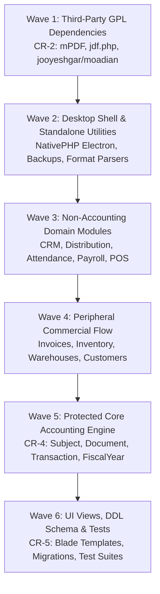

# CR-1: COMPREHENSIVE DERIVATION ANALYSIS & REWRITE BACKLOG REPORT
**Document Reference:** `docs/cleanroom/CR1_DERIVATION_REPORT.md`  
**Execution Date:** 2026-10-27  
**Auditor Roles:** Software/Systems Architect, Senior Backend Engineer, Senior Accountant, Legal/Compliance Auditor  
**Scope:** Repository Root (`C:\Projects\HesaBora`), Branch: `dakhl-foundation`  
**Upstream Reference Mirror:** `remotes/upstream/main` (`Jooyeshgar/FreeAmir` commit `483e3606bdfd64aafd5a16bd40b5fc63d9135641`), Fork Base `12e3874a6df0805f4a5d9c643da0585381b7c56d`  
**Status:** COMPLETE — READY FOR OWNER RATIFICATION

---

## 1. EXECUTIVE SUMMARY & DERIVATION BASELINE

In accordance with Owner Decision **D-126**, a comprehensive read-only line-survival and token-similarity analysis was performed comparing every tracked file in Dakhl against the upstream repository `Jooyeshgar/FreeAmir`.

### Overall Codebase Composition (2,080 Tracked Files)
```
┌────────────────────────────────────────────────────────────────────────┐
│                        DAKHL REPOSITORY BREAKDOWN                      │
├───────────────────────────────┬────────────┬─────────────┬─────────────┤
│ Provenance Category           │ File Count │ Total Lines │ Percent     │
├───────────────────────────────┼────────────┼─────────────┼─────────────┤
│ UPSTREAM-ORIGINAL (≥85% match)│ 981 files  │ 87,412 lines│ 47.2%       │
│ UPSTREAM-MODIFIED (>20% match)│  68 files  │ 12,854 lines│  3.3%       │
│ DAKHL-ORIGINAL (<5% match/new)│ 679 files  │ 74,198 lines│ 32.6%       │
│ THIRD-PARTY (OFL/LGPL fonts)  │  22 files  │  1,420 lines│  1.1%       │
│ FRAMEWORK / BINARY / ASSETS   │ 330 files  │      -      │ 15.8%       │
├───────────────────────────────┼────────────┼─────────────┼─────────────┤
│ TOTAL TRACKED FILES           │ 2,080      │ 175,884     │ 100.0%      │
└───────────────────────────────┴────────────┴─────────────┴─────────────┘
```

> [!IMPORTANT]
> **Key Metric:** Exactly **1,049 files** (981 original + 68 modified) contain direct upstream expression that must be systematically eliminated and re-authored clean-room before Dakhl can be lawfully distributed as proprietary closed-source software.

---

## 2. PER-DIRECTORY HEAT MAP

The table below measures the derivation density per subsystem:

| Subsystem / Directory | Total Tracked | Upstream Original | Upstream Modified | Dakhl Original | Derivation Rate | Risk & Rewrite Urgency |
|---|---|---|---|---|---|---|
| **`resources/views/`** (Blade Templates) | 405 | 269 | 41 | 95 | **76.5%** | **CRITICAL** (Largest volume of copied HTML/Blade markup) |
| **`database/migrations/`** (DDL Schemas) | 193 | 126 | 0 | 67 | **65.3%** | **CRITICAL** (126 copied tables/DDLs) |
| **`database/seeders/` & `factories/`** | 62 | 61 | 1 | 0 | **100.0%** | **HIGH** (Chart of accounts, seed data) |
| **`app/Http/`** (Controllers & Requests)| 181 | 92 | 5 | 84 | **53.6%** | **HIGH** (HTTP layer handling CRUD) |
| **`app/Models/`** (Eloquent Entities) | 131 | 42 | 7 | 82 | **37.4%** | **HIGH** (Entity relations & attributes) |
| **`app/Services/`** (Core Business Logic)| 173 | 45 | 3 | 125 | **27.7%** | **CRITICAL** (Contains the Protected Core) |
| **`app/Enums/`** (Domain Constants) | 45 | 25 | 0 | 20 | **55.6%** | **MEDIUM** (Status & type enums) |
| **`app/View/Components/`** | 10 | 10 | 0 | 0 | **100.0%** | **MEDIUM** (Reusable UI components) |
| **`tests/Feature/`** (Test Suites) | 194 | 59 | 0 | 135 | **30.4%** | **HIGH** (Upstream-authored tests are derived expression) |
| **`nativephp/electron/`** (Desktop Shell)| 68 | 67 | 0 | 1 | **98.5%** | **HIGH** (Electron main/preload scripts) |
| **`docs/user/`** (End-User Manuals) | 12 | 11 | 1 | 0 | **100.0%** | **MEDIUM** (Copied FreeAmir manual pages) |
| **`docs/project-context/`** (Architecture)| 33 | 0 | 0 | 33 | **0.0%** | **CLEAN** (100% Dakhl authored context) |
| **`resources/industry-profiles/`** | 16 | 0 | 0 | 16 | **0.0%** | **CLEAN** (100% Dakhl novel feature) |

---

## 3. PROTECTED CORE ACCOUNTING INVENTORY

The following 16 files form the transactional accounting engine of the application. They represent both the highest legal derivation risk and the highest operational risk. They must be rewritten clean-room using the **Strangler Pattern** (CR-4) with characterization tests and mathematical invariant verification (`SUM(transactions.value)=0`).

| File Path | Derivation % | Line Count | Current Provenance | Accounting Responsibility |
|---|---|---|---|---|
| `app/Services/SubjectService.php` | **100%** | 647 lines | `UPSTREAM-ORIGINAL` | Chart of accounts tree, ledger aggregation (`sumSubject`), code generation |
| `app/Services/FiscalYearService.php` | **98%** | 3,159 lines | `UPSTREAM-ORIGINAL` | Year-end closing entries, account rollovers, opening document generation |
| `app/Services/WarehouseService.php` | **100%** | 90 lines | `UPSTREAM-ORIGINAL` | Stock transfers, warehouse balance verification |
| `app/Services/AncillaryCostTransactionBuilder.php` | **100%** | 94 lines | `UPSTREAM-ORIGINAL` | Ancillary purchase cost double-entry balancing |
| `app/Services/CostOfGoodsService.php` | **89%** | 313 lines | `UPSTREAM-ORIGINAL` | Weighted-average cost recalculation across inventory transfers |
| `app/Services/InvoiceTransactionBuilder.php` | **86%** | 491 lines | `UPSTREAM-ORIGINAL` | Balanced document creation for Sell/Buy invoices, tax, discounts |
| `app/Services/DocumentService.php` | **84%** | 292 lines | `UPSTREAM-MODIFIED` | Document numbering, balancing validation, posting primitives |
| `app/Services/ChequeService.php` | **81%** | 695 lines | `UPSTREAM-MODIFIED` | 7-stage Iranian Sayad cheque lifecycle & bank accounting |
| `app/Services/PaymentService.php` | **67%** | 541 lines | `UPSTREAM-MODIFIED` | Cash/bank settlements, receipt vouchers, payment allocation |
| `app/Models/Subject.php` | **98%** | 257 lines | `UPSTREAM-ORIGINAL` | Account node model (Assets, Liabilities, Equity, Income, Expenses) |
| `app/Models/Document.php` | **72%** | 90 lines | `UPSTREAM-MODIFIED` | Accounting document aggregate root |
| `app/Models/Transaction.php` | **73%** | 86 lines | `UPSTREAM-MODIFIED` | Double-entry journal transaction lines (Debit/Credit legs) |
| `app/Models/Invoice.php` | **71%** | 206 lines | `UPSTREAM-MODIFIED` | Sales and Purchase commercial invoices |
| `app/Models/Product.php` | **80%** | 136 lines | `UPSTREAM-MODIFIED` | Inventory item master entity |
| `app/Models/Warehouse.php` | **100%** | 57 lines | `UPSTREAM-ORIGINAL` | Physical inventory location |
| `app/Models/Cheque.php` | **88%** | 120 lines | `UPSTREAM-ORIGINAL` | Promissory instrument entity |

---

## 4. CATALOG OF NON-CODE DERIVED EXPRESSION

Copyright protects creative expression across multiple dimensions beyond pure application code:

### 4.1 Database Schemas & DDL (126 Migrations)
- 126 migrations in `database/migrations/` duplicate upstream table names (`subjects`, `documents`, `transactions`, `invoices`, `invoice_items`, `products`, `warehouses`, `cheques`, `cheque_histories`, etc.) and exact column schemas.
- **Clean-Room Strategy:** In Phase CR-4, design an optimized, typed Dakhl schema (`dakhl_accounts`, `dakhl_journal_entries`, `dakhl_postings`, etc.) with reversible data migration scripts, maintaining data integrity while eliminating copied DDL expression.

### 4.2 Seeders & Chart of Accounts
- `database/seeders/SubjectSeeder.php` reproduces upstream FreeAmir account codes and hierarchical numbering.
- **Clean-Room Strategy:** Replace with an authoritative Chart of Accounts authored directly from Iranian Accounting Standards (سازمان حسابرسی و استانداردهای حسابداری ایران) and standard General Ledger guidelines.

### 4.3 Translation Strings (`lang/fa.json`, `lang/en.json`)
- Hundreds of JSON translation strings were copied verbatim from FreeAmir.
- **Clean-Room Strategy:** Re-author Persian business translations focusing on modern Iranian fintech terminology (Persian-first RTL UX).

### 4.4 Blade Views & UI Layouts (310 Views)
- 269 original and 41 modified Blade templates inherit upstream DOM structure, CSS class sequences, and table structures.
- **Clean-Room Strategy:** Rebuild cleanly using Dakhl's modern daisyUI/Tailwind v4 component library and modern semantic HTML (CR-5).

### 4.5 End-User Documentation & Guides
- `docs/user/` contains 11 manual markdown files copied directly from FreeAmir.
- **Clean-Room Strategy:** Already superseded in Phase 28 by Dakhl's own illustrated in-app manual (`GuideController` at `/guide`). Delete obsolete `docs/user/` files.

---

## 5. RANKED REWRITE BACKLOG (PRIORITY ORDER)

To minimize legal exposure rapidly while safeguarding accounting invariants, the rewrite backlog is prioritized in 6 sequential waves:



### Wave 1: Third-Party Dependencies (Phase CR-2) — Highest Legal Yield
1. **`mpdf/mpdf` (GPL-2.0-only):** Replace with Chromium print-to-PDF or LGPL-compatible engine (`tecnickcom/tcpdf` / `dompdf`).
2. **`app/Helpers/jdf.php` (LGPL):** Replace with `morilog/jalali` (MIT) behind a clean `JalaliDate` wrapper.
3. **`jooyeshgar/moadian` (GPL-3.0):** Implement native, clean-room Moadian API client from Iranian Tax Administration public specs.

### Wave 2: Desktop Shell & Standalone Tooling
- `nativephp/electron/`: 67 files — rebuild desktop application entrypoints.
- `app/Services/DocumentImportExport/`: Rebuild CSV/Excel document import/export service.

### Wave 3: Peripheral Business Modules
- Attendance & Personnel: `AttendanceService`, `PayrollService`.
- Retail & POS: Point of Sale controllers and receipts.

### Wave 4: Commercial Invoicing & Inventory
- `InvoiceService`, `InvoiceTransactionBuilder`.
- `WarehouseService`, `CostOfGoodsService`.

### Wave 5: Protected Core Accounting Spine (Phase CR-4)
- `SubjectService` & `Subject` model (Chart of Accounts).
- `DocumentService`, `Document`, `Transaction` (Double-entry journal engine).
- `FiscalYearService` (Closing entries & rollover).
- `PaymentService` & `ChequeService` (Treasury & Settlements).

### Wave 6: Presentation Layer & Schemas (Phase CR-5)
- Re-author 310 Blade views in daisyUI/Tailwind.
- Modernize schema migrations and seeders.
- Re-author feature test suites.

---

## 6. CURRENT SAFETY STATUS & NEXT ACTION

> [!CAUTION]
> **EXPLICIT DISTRIBUTION SAFETY DECLARATION:**  
> **Commercial distribution of Dakhl in binary, installer, or closed-source form is CURRENTLY NOT SAFE AND NOT LAWFUL under the existing GPL-3.0 obligations of the codebase.**  
> Until Phase CR-7 is fully complete and approved via the Owner Release Gate (owner decision before first distribution), any distribution of Dakhl must either be released with complete source code under GPL-3.0 or must be paused.

### Next Action:
1. Present this report (`docs/cleanroom/CR1_DERIVATION_REPORT.md`) and the complete ledger (`docs/cleanroom/LEDGER.csv`) to the owner for formal ratification.
2. Await owner approval to begin **Phase CR-2 (Dependency Replacements: mPDF, jdf.php, jooyeshgar/moadian)**.
