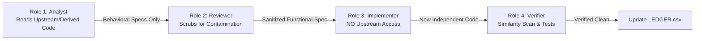

# DAKHL CLEAN-ROOM CODE ELIMINATION SYSTEM
**Directory:** `docs/cleanroom/`  
**Mandate:** Clean-Room Elimination of Upstream GPL-3.0 Derived Code (Decision D-126)  
**Established:** 2026-10-27  

---

## 1. PURPOSE & PRINCIPLES
Dakhl (دخل) is transitioning from its heritage base (forked from FreeAmir under GPL-3.0) to an independently authored, clean-room software architecture. To allow Dakhl to be released and commercialized under its own proprietary terms, all expression derived from upstream GPL-3.0 code or GPL-only components must be eliminated and replaced clean-room without copyright contamination.

### Non-Negotiable Honesty & Governance Rules
1. **Notice Preservation During Transition:** No copyright notice, license text, or attribution file may be removed or altered until that specific component has been 100% replaced clean-room, recorded as clean in `LEDGER.csv`, and approved via the Owner Release Gate (owner decision before first distribution) (CR-7).
2. **Distribution Ban:** No closed-source build, installer, or update may be distributed while any derived component remains in the shipped product.
3. **Idea vs. Expression:** Copyright protects expression (code text, comments, naming sequences, schema text, UI markup), NOT general double-entry accounting rules, tax laws, or standard business concepts.
4. **Separation of Roles:** To prevent copyright contamination, implementers of clean-room code MUST NOT read or consult upstream GPL source code.

---

## 2. CLEAN-ROOM ROLES & RESPONSIBILITIES

### Role 1: Analyst (Spec Author)
- **Access:** Permitted to read upstream source code, existing Dakhl code, and git history.
- **Output:** Writes behavioral specifications in `docs/cleanroom/SPECS/<unit>.md`.
- **Constraint:** Strictly forbidden from writing production code for the replacement unit. Specifications must describe inputs, outputs, mathematical invariants, domain rules, and edge cases in prose and markdown tables. No code snippets, verbatim variable/column names, or comments may be copied.

### Role 2: Reviewer (Contamination Firewall)
- **Access:** Inspects `docs/cleanroom/SPECS/`.
- **Function:** Rigorously scrubs specifications for contaminated expression (verbatim code fragments, distinctive internal identifiers, upstream comments, translated string literals).
- **Gate:** Approves sanitized specs or rejects them back to the Analyst.

### Role 3: Implementer (Clean-Room Developer)
- **Access:** STRICTLY BLOCKED from reading upstream repository files, upstream git logs, upstream test cases, or the original derived file.
- **Inputs:** Receives ONLY the Reviewer-approved functional spec, public interfaces, Dakhl's existing characterization tests, official public documentation (laws, tax circulars, library manuals).
- **Function:** Authors the clean replacement in Dakhl's modern architectural conventions (Laravel 12, strict types, DTOs, domain transaction builders).

### Role 4: Verifier (Auditor & Quality Gate)
- **Access:** Has access to both upstream and clean-room trees.
- **Function:** Runs characterization test suites, invariant verification (`SUM(transactions.value)=0`), race-condition checks on MariaDB/SQLite, and executes token similarity scans against upstream mirror.
- **Gate:** Records similarity metrics in `docs/cleanroom/SIMILARITY/` and updates provenance in `docs/cleanroom/LEDGER.csv`.

---

## 3. PROVENANCE CLASSIFICATIONS (`LEDGER.csv`)

| Classification | Definition | Rewrite Threshold & Action |
|---|---|---|
| `UPSTREAM-ORIGINAL` | Code/file identical or nearly identical (≥85%) to upstream FreeAmir. | **Must be rewritten clean-room.** Priority: CRITICAL. |
| `UPSTREAM-MODIFIED(>20%)` | Derived file with modifications (20% to 84% line survival/match). | **Must be rewritten clean-room.** Priority: HIGH. |
| `UPSTREAM-MODIFIED(5-20%)` | Low-derivation file with minor residual upstream lines (5% to 19%). | Must be rewritten or granted owner-approved exception via the Owner Release Gate. |
| `DAKHL-ORIGINAL` | Authored completely by Dakhl (<5% match or novel component created after fork). | Clean. Retained. |
| `THIRD-PARTY(licensed)` | External open-source dependency with compatible license (OFL-1.1, LGPL linking). | Keep license notices in `THIRD_PARTY_NOTICES.md`. |
| `FRAMEWORK(MIT)` | Laravel skeleton framework boilerplate files. | Permissive MIT license. |
| `GENERATED` | Build artifacts, lockfiles, or auto-generated mapping files. | Rebuilt automatically. |

---

## 4. DIRECTORY STRUCTURE & UPSTREAM MIRROR ISOLATION
- `README.md`: This governance guide.
- `LOG.md`: Chronological audit log of all clean-room operations, participants, and session access boundaries.
- `LEDGER.csv`: Comprehensive, per-file provenance tracking database for all tracked files.
- `SPECS/`: Sanitized behavioral specifications produced by the Analyst and approved by the Reviewer.
- `SIMILARITY/`: Output logs from token similarity and clone-detection scans verifying clean replacements.
- `CR1_DERIVATION_REPORT.md`: Initial comprehensive baseline report measuring derivation across all modules.

> [!IMPORTANT]
> **Strict Upstream Mirror Isolation:**  
> The read-only reference archive of upstream GPL components (FreeAmir and `jooyeshgar/moadian` v3.0.0) is stored strictly outside the repository workspace at `C:\Reference\upstream-mirror`.  
> No upstream source code or mirror files may reside within `c:\Projects\HesaBora` or be packaged into distribution builds.
