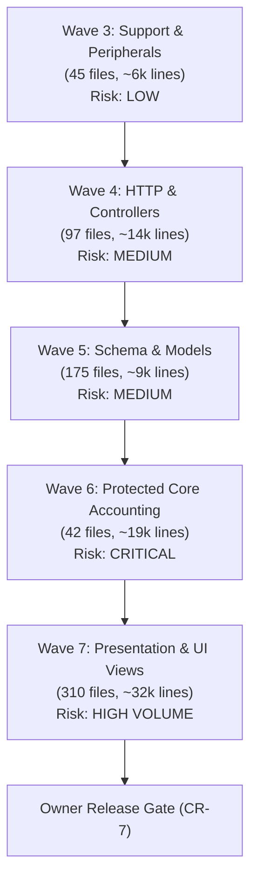

# Dakhl Clean-Room Elimination: System Status & Strategic Roadmap

**Document Version:** 1.0.0  
**Timestamp:** 2026-10-29T09:22:00+03:30  
**Status:** Official Status Report for Owner Decision  
**Binding Directives:** Decision D-126, Master Context r16  

---

## 1. Executive Summary & Provenance Snapshot

The objective of the Clean-Room Elimination initiative (Decision D-126) is to replace all expressive code derived from the upstream GPL-3.0 FreeAmir base, enabling Dakhl to be distributed, licensed, and commercialized under its own proprietary terms upon reaching the **Owner Release Gate** (CR-7).

As of October 29, 2026, Waves CR-0, CR-1, CR-2, and CR Wave 2 have completed initial replacements and provenance reclassifications.

### Current Provenance Distribution (`docs/cleanroom/LEDGER.csv`):

| Provenance Category | File Count | Percentage | Definition & Policy |
|---|:---:|:---:|---|
| **`UPSTREAM-ORIGINAL`** | **908** | **43.3%** | Unaltered or closely adapted upstream GPL-3.0 files. Must be eliminated. |
| **`DAKHL-ORIGINAL`** | **679** | **32.4%** | Newly authored Dakhl features (Phase 1–30, Sync, Audit, Reversal, POS). Clean. |
| **`BINARY/ASSET`** | **323** | **15.4%** | Images, fonts (OFL-1.1), icons, and binary fixtures. |
| **`THIRD-PARTY(licensed)`** | **89** | **4.2%** | External open-source components with verified commercial licenses (NativePHP Electron MIT templates, etc.). |
| **`UPSTREAM-MODIFIED(>20%)`** | **68** | **3.2%** | Heavily customized upstream files retaining >20% line overlap. Must be eliminated. |
| **`REWRITTEN-LOW-SIMILARITY`** | **27** | **1.3%** | Re-implemented modules (`Moadian`, `DocumentImportExport`) authored in single session (contaminated author). |
| **`FRAMEWORK(MIT)`** | **7** | **0.3%** | Standard Laravel framework boilerplates. Clean. |
| **`CLEANROOM-REIMPLEMENTED`** | **0** | **0.0%** | Reserved strictly for units authored by an untainted Implementer session. |
| **TOTAL TRACKED FILES** | **2,101** | **100%** | |

> [!IMPORTANT]
> **Total Derived Files Remaining:** **976 files** (908 `UPSTREAM-ORIGINAL` + 68 `UPSTREAM-MODIFIED`), encompassing **153,222 lines of code**.  
> **Commercial Release Status:** No closed-source distribution (desktop installer, private SaaS, update channel) may occur while any of these 976 files remain in the codebase.

---

## 2. Derived Files Remaining by Directory & Architectural Layer

Analysis of the 976 remaining derived files reveals heavy concentration in legacy presentation views and feature tests:

| Directory / Architectural Layer | File Count | Upstream Lines | Architectural Role & Risk Profile |
|---|:---:|:---:|---|
| `resources/views/` | 310 files | 32,454 lines | **Legacy Blade Views:** Presentation markup, forms, tables. Low accounting risk; high line volume. |
| `tests/Feature/` | 59 files | 28,486 lines | **Upstream Feature Tests:** High value for behavior verification during rewrites; must be rewritten or replaced with fresh behavioral specs. |
| `app/Services/` | 42 files | 19,278 lines | **PROTECTED ACCOUNTING CORE:** Transaction builders, Cost of Goods (FIFO/LIFO/Average), Cheque lifecycle, Fiscal year rollover. **CRITICAL RISK.** |
| `app/Http/` (Controllers & Requests) | 97 files | 13,734 lines | **HTTP & Web API Layer:** Thin controllers and form request validation rules. Medium risk. |
| `root` / Infrastructure | 20 files | 16,775 lines | Dockerfiles, composer/npm lockfiles, configuration. Low risk. |
| `lang/` | 2 files | 7,982 lines | Localization JSON (`lang/fa.json` has 7,370 lines). Medium copyright risk in literal wording. |
| `database/migrations/` | 126 files | 5,666 lines | Table schemas and indexes. Facts/DDL are largely uncopyrightable, but naming sequences must be sanitized. |
| `app/Models/` | 49 files | 3,518 lines | Eloquent models, relationships, and scopes. Medium risk. |
| `database/seeders/` | 28 files | 2,429 lines | Chart of accounts seeders and demo datasets. Low risk. |
| `config/` | 20 files | 2,097 lines | Laravel config files. Low risk. |
| `app/Enums/` | 25 files | 1,989 lines | Domain enums and state definitions. Low risk. |
| `database/factories/` | 34 files | 1,766 lines | Model factories for testing. Low risk. |
| `docs/` (Upstream documentation) | 49 files | 8,166 lines | Upstream guides and markdown manuals. Must be archived or replaced. |
| `docker/` & `script/` | 41 files | 3,365 lines | Container configs and deployment scripts. Low risk. |
| `app/View/`, `app/Helpers/`, Misc | 24 files | 1,757 lines | Blade components and autoloaded helpers. Low risk. |
| **TOTAL REMAINING** | **976 files** | **153,222 lines** | |

---

## 3. Estimated Effort & Risk Analysis by Future Wave

### Detailed Wave Assessment:
1. **Wave 3 — Auxiliary Peripherals & Support Services (Estimated: 45 files, ~6,000 lines)**
   - *Scope:* Activity logging, inquiry services, notifications, report exporters, number-to-words helpers, formatters.
   - *Risk:* **LOW**. No double-entry posting invariants or transaction locks touched.
2. **Wave 4 — HTTP Controllers & Form Requests (Estimated: 97 files, ~13,700 lines)**
   - *Scope:* Resource controllers (`app/Http/Controllers/*`), request validation rules (`app/Http/Requests/*`).
   - *Risk:* **MEDIUM**. Controllers are already thin; primary challenge is decoupling from legacy response shapes.
3. **Wave 5 — Database Schemas, Models & Seeders (Estimated: 175 files, ~9,200 lines)**
   - *Scope:* Migrations, Eloquent model relationships, global scopes (`FiscalYearScope`), seeders.
   - *Risk:* **MEDIUM-HIGH**. Must maintain backward compatibility with existing databases and UUID sync identity (Decision D-071).
4. **Wave 6 — Protected Core Accounting Engine (Estimated: 42 files, ~19,300 lines)**
   - *Scope:* `TransactionBuilder`, `InvoiceTransactionBuilder`, `CostOfGoodsService`, `FiscalYearService`, `ChequeService`, `PaymentService`, `SettlementService`.
   - *Risk:* **CRITICAL**. Enforces $\sum \text{Debit} = \sum \text{Credit}$, multi-currency, VAT compliance, locked period immutability (D-084, D-127, D-128). Requires strict fail-first regression tests.
5. **Wave 7 — Presentation Views & Frontend Localization (Estimated: 310 files, ~32,500 lines)**
   - *Scope:* 310 Blade view templates in `resources/views/`, `lang/fa.json`.
   - *Risk:* **HIGH VOLUME / REDUNDANCY CONFLICT**. Rewriting 310 legacy views that are scheduled to be replaced in the modern UI redesign is highly inefficient.

---

## 4. Strategic Architecture Decision Analysis (The 3 Paths)

The owner faces three mutually exclusive strategic options regarding the remaining 976 derived files:

### Option (a): Complete Full Clean-Room Rewrite of All 976 Files
- **Mechanism:** Sequentially execute Waves 3 through 7 across all directories until zero derived files remain.
- **Pros:**
  - 100% proprietary code ownership across the entire application stack.
  - Complete legal freedom to close the source code, distribute binary installers, and enforce proprietary licensing without GPL copyleft obligations.
- **Cons:**
  - **Massive effort:** Rewriting ~153,000 lines across 976 files requires an estimated 160–240 engineering hours.
  - **Severe waste in UI:** Rewriting 310 legacy FreeAmir Blade views line-by-line while a modern DaisyUI/Tailwind frontend redesign is planned results in throwaway work.

### Option (b): Rewrite Core Only + Rebuild Views during UX Redesign (Recommended Hybrid)
- **Mechanism:** 
  1. Focus clean-room re-implementation strictly on the backend domain logic: **Core Accounting Services (Wave 6), Controllers (Wave 4), and Models/Migrations (Wave 5)** (~42,000 lines).
  2. **Do NOT rewrite the 310 legacy Blade views.** Instead, archive them and author a completely fresh, modern UI design system (Tailwind CSS, DaisyUI, Alpine.js) directly matching Dakhl's Persian-first design identity.
- **Pros:**
  - **Zero wasted work:** Completely avoids porting 32,500 lines of obsolete markup.
  - **Elevated product quality:** Delivers a modern, premium user experience instead of a clone of the 2018 FreeAmir UI.
  - **Full proprietary freedom achieved:** Once fresh views replace legacy views and the backend core is rewritten, zero GPL code remains.
  - **Reduces rewrite volume by >35%** (from 153k lines to ~42k backend lines + fresh views).
- **Cons:**
  - Requires UI design alignment before frontend templates can be completely cut over.

### Option (c): Retain GPL-3.0 Core + Open-Core Commercial Extension Model
- **Mechanism:**
  - Keep the base accounting engine open-source under GPL-3.0 (following upstream FreeAmir heritage, similar to Odoo Community Edition, ERPNext, or Gitlab).
  - Develop proprietary enterprise modules (such as Cloud Sync, Multi-Device Offline Sync, POS Hardware Integration, AI Invoice Scanning, Advanced Payroll) as decoupled, proprietary commercial extensions or SaaS offerings under commercial terms.
- **Pros:**
  - **Immediate commercial viability:** Eliminates the need to rewrite 976 files. The existing base can be utilized immediately.
  - **Community adoption & trust:** Open-core accounting software fosters strong grassroots developer adoption in Iran.
- **Cons:**
  - The core desktop application itself cannot be sold as a closed-source binary without providing corresponding source code under GPL-3.0 upon request.
  - Requires strict architectural boundaries between open-source core and proprietary plugins to prevent license contagion.

---

## 5. Formal Recommendation for Owner Ratification

> [!TIP]
> **LEAD ARCHITECT RECOMMENDATION:** **Option (b) — Rewrite Core Only + Fresh Modern UI.**
> 
> Rewriting legacy Blade views (310 files) line-for-line under clean-room rules is an anti-pattern: it expends enormous effort to reproduce outdated, clunky HTML templates that the project already plans to modernize.
> 
> By executing a clean-room rewrite of the **Backend Engine (Waves 4, 5, 6)** and simultaneously building the **New Dakhl Frontend** from original wireframes and UI components, Dakhl achieves 100% proprietary ownership, eliminates all GPL contamination, and launches with a modern product — saving an estimated 50% of total rewrite time.

---

## 6. Standing Guardrail (Decision D-126)

Until the owner ratifies a strategic path and Phase CR-7 is completed through the **Owner Release Gate**:
1. All distributions must either include complete corresponding source under GPL-3.0 or remain unreleased.
2. The agent will **STOP AND WAIT** for owner instruction before initiating any subsequent rewrite wave.
